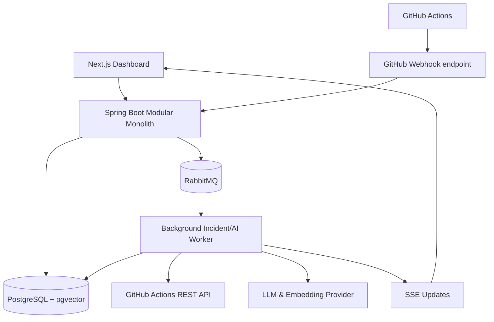

# TracePilot — Roadmap & Database Design

> AI-Powered DevOps & Incident Management Platform. Hướng triển khai: **Java + Spring Boot + PostgreSQL/pgvector**, có kiểm thử và triển khai thực tế. Đây là thiết kế đề xuất, không phải schema duy nhất.

## 0. Chức năng và phạm vi

**Bài toán:** kết nối GitHub Actions → nhận webhook → đồng bộ run và job → nhận diện pipeline thất bại → lấy log với quyền `Actions: read` → lọc bỏ secrets → đưa tác vụ vào RabbitMQ → AI phân tích nguyên nhân → RAG tìm lỗi cũ trong PostgreSQL/pgvector → hiển thị báo cáo/bằng chứng → người dùng xác nhận hướng khắc phục rồi ghi vào knowledge base.

**MVP:** Đăng nhập; 1 workspace; kết nối GitHub App/repository; theo dõi workflow; incident 1/run attempt; log snippet an toàn; báo cáo AI; duyệt knowledge; semantic retrieval; SSE; Docker; kiểm thử.

**Không làm trong MVP:** tự sửa hoặc push code, tự deploy sau khi AI đề xuất, Kubernetes, nhiều microservice, huấn luyện LLM riêng, billing subscription.

## 1. Stack công nghệ

| Lớp | Công nghệ | Lý do |
|---|---|---|
| Backend | Java 21 LTS, Spring Boot, Maven | Học Java/Spring Boot với API thực tế |
| REST | Spring MVC, Bean Validation, springdoc OpenAPI | HTTP, DTO, validation, tài liệu API |
| Auth | Spring Security, JWT access/refresh | Xác thực, role workspace; token refresh băm |
| Persistence | Spring Data JPA/Hibernate | Entity/repository, transaction, mapping |
| Migrations | Flyway | Quản lý schema theo version |
| Data | PostgreSQL 16+ | RDBMS, FK, transaction, index |
| Vector | pgvector, Spring AI PgVectorStore hoặc JDBC | RAG, embeddings, cosine similarity |
| Queue | RabbitMQ (Spring AMQP) | Background jobs, retry, DLQ |
| Cache (sau MVP) | Redis | Rate limiting, cache đọc |
| AI | Spring AI + LLM provider + embedding model | Structured output, RAG, usage metrics |
| GitHub | GitHub App + Webhooks + GitHub REST API | Quyền tối thiểu, xử lý workflow_run/jobs |
| Realtime | SSE | Trả trạng thái phân tích tới dashboard |
| Frontend | Next.js, TypeScript, Tailwind, shadcn/ui | Dashboard đơn giản, gọn và sáng sủa |
| Quality | JUnit 5, Mockito, Testcontainers, WireMock | Unit/integration/HTTP tests |
| DevOps | Docker Compose, GitHub Actions, Actuator/Micrometer | Chạy được, đo được, deploy được |

**Lưu ý:** chọn phiên bản Spring Boot/Spring AI tương thích tại thời điểm khởi tạo. `VECTOR(1536)` chỉ là ví dụ; cần khóa embedding model + dimension trước khi chạy migration. API key/secret ở environment/secret manager, không lưu trực tiếp vào DB. Không cần microservices ở giai đoạn đầu.

## 2. Kiến trúc



Module structure trong Spring Boot:

```text
com.tracepilot
  common/              # errors, response envelope, config, exceptions
  identity/            # register, login, refresh token
  workspace/           # workspace members and RBAC
  github/              # GitHub App installations, repositories, webhooks
  pipeline/            # workflow runs and jobs
  incident/            # incidents, safe log snippets, assignments
  analysis/            # AI orchestration, evidence, model usage
  knowledge/           # approved KB, chunks, pgvector retrieval
  notification/        # SSE + notification persistence
  audit/               # audit entries
  infrastructure/      # RabbitMQ, Redis, outbox, security, monitoring
```

NestJS → Spring Boot analogy: `@Controller` (Nest) ≈ `@RestController`; `@Injectable()` provider ≈ `@Service` / Spring Bean; Prisma/TypeORM repository ≈ Spring Data JPA Repository; NestJS Guard ≈ Spring Security filter/method authorization; BullMQ worker ≈ Spring AMQP listener; NestJS DTO + class-validator ≈ Java record + Jakarta Bean Validation.

## 3. Lộ trình từ cơ bản đến production

### Phase 00 — Scope & bootstrap
- **Kiến thức:** HTTP, module boundaries, package layout, Spring Initializr, Maven, Docker Compose.
- **Code:** App chạy được; `/actuator/health`; Postgres + RabbitMQ chạy bằng Docker; README với hướng dẫn chạy.
- **Database:** Chưa cần bảng nghiệp vụ. Cài pgvector, Flyway và quy tắc migration.
- **Xong khi:** clone repo → chạy Docker → chạy Spring Boot → health trả kết quả tốt, Flyway migrate thành công.

### Phase 01 — Users, Authentication & Workspace
- **Kiến thức:** Java entity/record, DTO, service/repository, validation, BCrypt/Argon2, JWT, `@Transactional`, Spring Security.
- **Model:** `users`, `refresh_tokens`, `workspaces`, `workspace_members`.
- **API:** `POST /api/v1/auth/register`, `POST /auth/login`, `POST /auth/refresh`, `POST /workspaces`, `POST /workspaces/{id}/members`.
- **Xong khi:** login chạy được; token bị revoke không refresh được; `MEMBER` không tự nâng mình thành `OWNER`; test user ở workspace A không đọc được workspace B.

### Phase 02 — GitHub App & secure webhook
- **Kiến thức:** webhook, raw-body HMAC SHA-256, GitHub App installation token, retry, deduplication.
- **Model:** `github_installations`, `repositories`, `webhook_deliveries`.
- **API:** `POST /webhooks/github` (public route nhưng luôn verify signature); `GET /api/v1/workspaces/{id}/repositories`.
- **Xong khi:** kết nối repo thật, secret/signature sai trả lỗi, cùng `X-GitHub-Delivery` gửi lại không xử lý trùng; không lưu private key/access token vào DB.

### Phase 03 — CI/CD pipeline ingestion
- **Kiến thức:** idempotent UPSERT, transaction, external API pagination, workflow run attempt, async job queue.
- **Model:** `workflow_runs`, `workflow_jobs`. **Nâng cao:** `outbox_events` để gửi message đáng tin cậy.
- **Luồng:** nhận `workflow_run` → đồng bộ run + jobs qua API → gửi message cho worker → retry/backoff, DLQ cho message lỗi.
- **Xong khi:** chạy GitHub Actions thật, dashboard thấy trạng thái; rerun phân biệt attempt; webhook gửi lặp không tạo 2 run.

### Phase 04 — Incident management & safe logs
- **Kiến thức:** domain lifecycle, optimistic locking/transaction, log redaction, assigned incident, indexes.
- **Model:** `incidents`, `incident_log_snippets`, `notifications` (mức cơ bản).
- **API:** `GET /incidents`, `GET /incidents/{id}`, `PATCH /incidents/{id}/status`, `GET /incidents/{id}/logs`.
- **Xong khi:** pipeline thất bại tạo đúng 1 incident/run attempt; log đã che secrets; status OPEN → INVESTIGATING → RESOLVED; SSE nhận cập nhật.

### Phase 05 — LLM-based root cause analysis
- **Kiến thức:** structured outputs, timeout, retries, prompt injection, evidence, cost tracking.
- **Model:** `ai_analyses`, `ai_usage_events`.
- **Luồng:** `incident` → RabbitMQ worker → lấy log đã redacted → LLM → validate JSON → lưu summary/root cause/suggested fix → SSE.
- **Xong khi:** tái phân tích tạo một `ai_analyses` mới, không ghi đè lịch sử; AI thất bại không làm mất incident; model không có quyền tự push/execute code.

### Phase 06 — pgvector & RAG
- **Kiến thức:** embedding, token/chunk, cosine similarity, HNSW, RAG, hybrid search, filtering tenant.
- **Model:** `knowledge_articles`, `knowledge_chunks`, `analysis_evidence`.
- **Luồng:** người dùng xác nhận fix → knowledge DRAFT → approve → chunks → embedding → pgvector. Khi có lỗi mới, truy vấn **chỉ knowledge APPROVED cùng workspace** rồi gửi top-K cho LLM; lưu evidence nguồn.
- **Xong khi:** tìm được lỗi tương tự khi diễn đạt khác; truy xuất không rò workspace; report AI dẫn nguồn log/knowledge; có tập test kiểm tra Recall@K.

### Phase 07 — Feedback & quality
- **Đã triển khai local:** migration V8, feedback cá nhân có version/redaction, API tổng hợp và dashboard Chất lượng AI. Định nghĩa metrics, API, bộ tham chiếu 6 ca và giới hạn bằng chứng ở [docs/phase-07.md](docs/phase-07.md).
- **Kiến thức:** measurement, evaluation dataset, SQL aggregation, false positives.
- **Model:** `incident_feedback`.
- **Xong khi:** developer có thể đánh giá AI hữu ích/không; có metrics latency, success rate, token/cost; dashboard tổng hợp lý do thường gặp.

### Phase 08 — Hardening & reliability
- **Hoàn tất kiểm chứng local ngày 09/11/2026:** audit cùng transaction, rate limit PostgreSQL, correlation ID, readiness, backlog metrics và retry workflow/log có kiểm quyền. Maven 133 test (19 Phase 08), 43 browser fixture và 9 live test đạt; container test/preview đã thu hồi. Đây là bằng chứng trên DB test riêng; DB Compose cũ chưa nâng cấp do lệch checksum V4. API, cách chạy preview và giới hạn bằng chứng ở [docs/phase-08.md](docs/phase-08.md).
- **Kiến thức:** outbox/inbox pattern, consumer idempotency, bounded retry/DLQ, RBAC, audit, rate limiting, transaction boundaries.
- **Model:** `audit_logs`, `outbox_events` (nếu chưa dùng), tối ưu index.
- **Xong khi:** xử lý lại message không tạo bản ghi sai; tenant isolation được test; có tracing/health/metrics; GitHub API và AI provider lỗi vẫn phục hồi được.

### Phase 09 — Shipping & CV
- **Kiến thức:** Docker multi-stage build, CI/CD, deployment, observability, README, architecture decision records.
- **Deliverables:** demo URL nếu host đủ tài nguyên; GitHub repo sạch; screenshot; ERD; API documentation; test results; sample incident; performance report.
- **Xong khi:** reviewer có thể tự chạy stack bằng Docker Compose, tạo một workflow fail và thấy báo cáo AI với dẫn nguồn.

**Thứ tự hợp lý để có MVP:** Phase 00–06; Phase 07–09 nâng độ tin cậy và giá trị phỏng vấn. Chỉ thêm Redis khi có use case cache/rate limit thực sự; RabbitMQ đã đảm nhận hàng đợi.

## 4. Thiết kế database — 20 model

### A. Identity & Workspace (Phase 01)

**1. `users` — tài khoản người dùng**
- `id UUID PK`; `email VARCHAR(320)` (unique không phân biệt hoa/thường); `password_hash TEXT`; `display_name VARCHAR(120)`; `avatar_url TEXT?`; `created_at`, `updated_at TIMESTAMPTZ`.
- **Quan hệ:** 1 user → nhiều refresh token, workspace membership, báo cáo feedback.
- **Lý do:** tách thông tin đăng nhập và quyền theo từng workspace.

**2. `refresh_tokens` — phiên đăng nhập**
- `id UUID PK`; `user_id UUID FK users`; `token_hash CHAR(64) UNIQUE`; `expires_at`; `revoked_at?`; `created_at`.
- Chỉ lưu **hash** của token, không lưu refresh token dạng rõ.

**3. `workspaces` — nhóm làm việc**
- `id UUID PK`; `name VARCHAR(120)`; `slug VARCHAR(120) UNIQUE`; `created_by UUID FK users`; timestamps.
- 1 workspace có nhiều thành viên, repo, incident, bài knowledge.

**4. `workspace_members` — liên kết user/workspace (N–N)**
- `id UUID PK`; `workspace_id FK`; `user_id FK`; `role OWNER|ADMIN|MEMBER`; `status ACTIVE|REMOVED`; `joined_at`.
- `UNIQUE(workspace_id,user_id)` ngăn membership trùng.

### B. GitHub & CI/CD (Phases 02–03)

**5. `github_installations` — GitHub App installation**
- `id UUID PK`; `workspace_id FK`; `github_installation_id BIGINT UNIQUE`; `account_login`; `status`; timestamps.
- Không lưu access token ngắn hạn, secret hoặc private key.

**6. `repositories` — repository được theo dõi**
- `id UUID PK`; `workspace_id FK`; `installation_id FK`; `github_repository_id BIGINT`; `full_name`; `default_branch`; `is_active`; timestamps.
- `UNIQUE(workspace_id,github_repository_id)`; tenant scope luôn được kiểm tra.

**7. `webhook_deliveries` — inbox chống trùng webhook**
- `id UUID PK`; `github_delivery_id VARCHAR(128) UNIQUE`; `installation_id? FK`; `repository_id? FK`; `event_type`; `event_action?`; `payload_sha256`; `status`; `attempts`; `last_error?`; `received_at`; `processed_at?`.
- Chỉ lưu metadata + digest; nhận webhook phải validate HMAC trên **raw request body** trước khi tin dữ liệu.

**8. `workflow_runs` — một lần chạy workflow**
- `id UUID PK`; `repository_id FK`; `github_run_id BIGINT`; `run_attempt INT`; `github_workflow_id?`; `workflow_name`; `head_branch?`; `head_sha?`; `status`; `conclusion?`; `html_url?`; `started_at?`; `completed_at?`; timestamps.
- `UNIQUE(repository_id, github_run_id, run_attempt)` xử lý rerun đúng.

**9. `workflow_jobs` — từng job trong workflow**
- `id UUID PK`; `workflow_run_id FK`; `github_job_id BIGINT`; `name`; `status`; `conclusion?`; `html_url?`; `started_at?`; `completed_at?`.
- `UNIQUE(workflow_run_id, github_job_id)`.

### C. Incident management (Phase 04)

**10. `incidents` — sự cố pipeline**
- `id UUID PK`; `workspace_id FK`; `repository_id FK`; `workflow_run_id UUID UNIQUE FK`; `failed_job_id? FK`; `assigned_to? FK users`; `title`; `status OPEN|INVESTIGATING|RESOLVED|IGNORED`; `severity`; `error_fingerprint?`; `detected_at`; `resolved_at?`; timestamps.
- MVP quy định **tối đa một incident cho mỗi workflow run attempt**; incident là domain object trung tâm.

**11. `incident_log_snippets` — log an toàn theo đoạn**
- `id UUID PK`; `incident_id FK`; `workflow_job_id? FK`; `chunk_index INT`; `content TEXT` (đã redacted); `content_sha256`; `source_url?`; `captured_at`.
- `UNIQUE(incident_id,chunk_index)`. Không lưu raw full logs nếu chưa có chính sách retention/bảo vệ dữ liệu.

**12. `notifications` — thông báo**
- `id UUID PK`; `workspace_id FK`; `user_id FK`; `incident_id? FK`; `type`; `title`; `body?`; `read_at?`; `created_at`.
- SSE phát sự kiện; DB giữ trạng thái thông báo để refresh trang không mất dữ liệu.

### D. AI analysis & RAG (Phases 05–07)

**13. `ai_analyses` — lịch sử từng lần AI phân tích**
- `id UUID PK`; `incident_id FK`; `provider`; `model`; `prompt_version`; `status PENDING|RUNNING|SUCCEEDED|FAILED`; `summary?`; `suspected_root_cause?`; `suggested_fix?`; `error_message?`; `started_at?`; `completed_at?`; `created_at`.
- Phân tích lại tạo bản ghi mới, không overwrite bản cũ.

**14. `knowledge_articles` — tài liệu fix đã có người xác nhận**
- `id UUID PK`; `workspace_id FK`; `source_incident_id? FK`; `title`; `root_cause`; `resolution`; `status DRAFT|APPROVED|ARCHIVED`; `created_by FK`; `approved_by? FK`; `approved_at?`; timestamps.
- Chỉ `APPROVED` được đưa vào context RAG.

**15. `knowledge_chunks` — đoạn kiến thức có embedding**
- `id UUID PK`; `workspace_id FK`; `article_id FK`; `chunk_index`; `content`; `embedding VECTOR(1536)`; `embedding_model`; `created_at`.
- `UNIQUE(article_id,chunk_index)`, HNSW index cho cosine similarity. Dimension 1536 là ví dụ; **không đổi embedding model/dimension tùy tiện**.

**16. `analysis_evidence` — nguồn dẫn chứng của kết quả AI**
- `id UUID PK`; `analysis_id FK`; `log_snippet_id? FK`; `knowledge_chunk_id? FK`; `similarity_score?`; `created_at`.
- Constraint yêu cầu **đúng một** trong `log_snippet_id` hoặc `knowledge_chunk_id` có giá trị. Không để AI tạo nguồn giả.

**17. `ai_usage_events` — chi phí và token**
- `id UUID PK`; `workspace_id FK`; `analysis_id? FK`; `operation CHAT|EMBEDDING`; `provider`; `model`; `input_tokens?`; `output_tokens?`; `estimated_cost_usd?`; `created_at`.
- Token/cost chỉ là dữ liệu ghi nhận/ước tính từ provider hoặc bảng giá bạn định nghĩa; không tự bịa.

**18. `incident_feedback` — đánh giá đầu ra AI**
- `id UUID PK`; `analysis_id FK`; `user_id FK`; `helpful BOOLEAN`; `comment?`; `created_at`.
- `UNIQUE(analysis_id,user_id)`.

### E. Production / reliability (Phase 08)

**19. `audit_logs` — lịch sử thao tác quan trọng**
- `id UUID PK`; `workspace_id FK`; `actor_user_id? FK`; `action`; `entity_type`; `entity_id?`; `metadata JSONB`; `created_at`.
- Ghi ai duyệt knowledge, ai đổi status, ai gán incident; không ghi secrets vào metadata.

**20. `outbox_events` — sự kiện chờ publish RabbitMQ**
- `id UUID PK`; `aggregate_type`; `aggregate_id`; `event_type`; `payload JSONB`; `status PENDING|PUBLISHED|FAILED`; `attempts`; `available_at`; `published_at?`; `created_at`.
- Trong một transaction, ghi dữ liệu nghiệp vụ và outbox; publisher gửi message, sau đó mark `PUBLISHED`. Consumer vẫn cần idempotency vì có thể nhận trùng.

## 5. Quan hệ quan trọng

- `users` N–N `workspaces` thông qua `workspace_members`.
- `workspaces` 1–N `github_installations` và `repositories`.
- `repositories` 1–N `workflow_runs`.
- `workflow_runs` 1–N `workflow_jobs`.
- `workflow_runs` 1–0..1 `incidents` **trong MVP**.
- `incidents` 1–N `incident_log_snippets` / `ai_analyses`.
- `knowledge_articles` 1–N `knowledge_chunks`; `analysis_evidence` liên kết báo cáo AI với một chunk log hoặc KB.
- `workspaces` 1–N `knowledge_articles` / `ai_usage_events` / `notifications` / `audit_logs`.

Để xem dễ hơn, có **3 ERD nhỏ** (`ERD_01`, `ERD_02`, `ERD_03`) và **1 file DBML đầy đủ**. SQL của từng model, toàn bộ FK/index/constraint nằm trong `V1__init.sql`.

## 6. Ví dụ pgvector search

Sau khi tạo `query_embedding` với đúng embedding model/dimension của knowledge đã lưu, có thể tìm top 5 bài APPROVED:

```sql
SELECT k.id, k.article_id, k.content,
       1 - (k.embedding <=> CAST(:query_embedding AS vector)) AS cosine_similarity
FROM knowledge_chunks k
JOIN knowledge_articles a ON a.id = k.article_id
WHERE k.workspace_id = :workspace_id
  AND a.workspace_id = :workspace_id
  AND a.status = 'APPROVED'
ORDER BY k.embedding <=> CAST(:query_embedding AS vector)
LIMIT 5;
```

**Chú ý:** HNSW là approximate nearest neighbor; khi filter workspace/status, tùy kích thước dữ liệu và độ phân bố, cần kiểm tra index plan và Recall@K. Với tập nhỏ, exact scan có thể tốt hơn; nên cân nhắc full-text search bổ sung cho các mã lỗi có ký tự chính xác.

## 7. Checklist chất lượng trước khi đưa CV

- [ ] Integration test auth/RBAC, cross-tenant access.
- [ ] Test webhook signature invalid và duplicate deliveries.
- [ ] Simulate workflow rerun và duplicated RabbitMQ message.
- [ ] Test không lộ secrets khi lưu log và gửi prompt.
- [ ] Test AI timeout/error; retry bounded và có DLQ.
- [ ] Test RAG chỉ đọc APPROVED knowledge trong đúng workspace.
- [ ] Evaluation set lỗi có ground truth; đo Retrieval Recall@K và chất lượng suggestion.
- [ ] Test schema migration chạy sạch từ database mới.
- [ ] Có Swagger/OpenAPI, README, Docker Compose, demo và ảnh chụp dashboard.

## 8. Cách mở file

- **VSCode:** cài extension DBML (hoặc `dbdiagram.io` để nhập `.dbml`); mở `.sql` bằng SQL syntax; mở `.mmd` với Mermaid Preview.
- **IntelliJ IDEA:** `.sql` có hỗ trợ SQL; dùng Database Tools nếu phiên bản/edition hỗ trợ để kết nối PostgreSQL và xem schema. `.dbml`/`.mmd` cần plugin tương ứng nếu muốn preview đồ họa.
- **Flyway:** đặt `V1__init.sql` trong `src/main/resources/db/migration` (sử dụng như **baseline schema cho database mới**, không chạy lại trên schema đã có).
- Trong phát triển thực tế nên chia `V1__init.sql` thành nhiều migration nhỏ theo phase (`V1`, `V2`, `V3`, ...). File gộp này để đọc/bootstrapping nhanh.

## 9. Các điểm cần tinh chỉnh khi hướng tới production

1. Ứng dụng phải **kiểm tra `workspace_id` nhất quán trên mọi mối quan hệ**; FK đơn lẻ không bảo đảm không liên kết chéo tenant. Có thể tăng an toàn bằng composite FK và/hoặc Row-Level Security.
2. Nên có retention policy cho log, usage, webhook, audit; giới hạn kích thước log và số lần gọi AI.
3. `updated_at` cần cập nhật bởi application hoặc DB trigger, không tự động cập nhật bởi default `now()`.
4. Nếu một run có nhiều job thất bại và cần tạo mỗi job một incident, thay unique key `workflow_run_id` bằng ràng buộc trên `(workflow_run_id, failed_job_id)` cùng chiến lược xử lý `NULL`.
5. Để tránh lưu quá nhiều dữ liệu, chỉ embedding các knowledge article đã được phê duyệt; nếu sửa, phải regenerate chunks và cập nhật vector atomically.
6. Luôn có bước human review trước khi thực thi command/patch/deploy do AI đề xuất.

---

**Tổng quan:** 20 model là **schema mục tiêu**, không phải yêu cầu phải viết toàn bộ trong Phase 01. Hãy code từng nhóm nhỏ, tạo migration cho từng phase, test xong rồi mới học phần sau.
