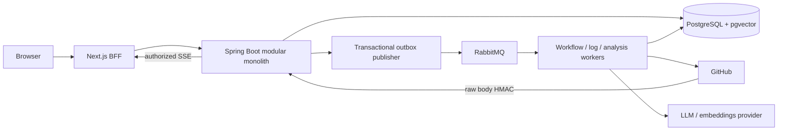
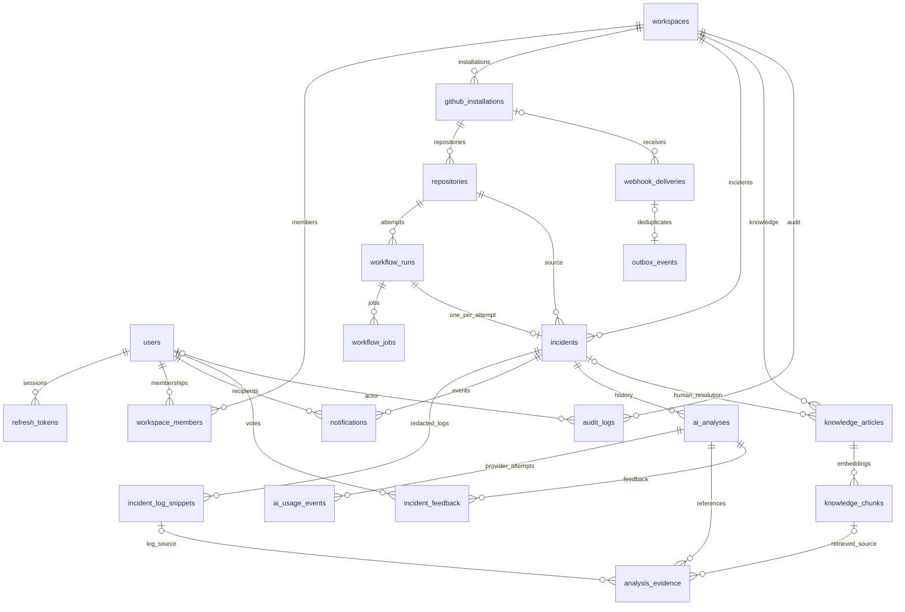

# Kiến trúc và database đang triển khai

Source schema là Flyway **V1–V9** trong `backend/src/main/resources/db/migration/`, không phải file SQL tham khảo ở root. Sơ đồ dưới đây lược bỏ một số FK người tạo/người duyệt để dễ đọc; các ràng buộc workspace kép vẫn nằm trong migration.

`outbox_events.aggregate_id` là repository UUID trong hợp đồng ứng dụng, không có FK polymorphic trực tiếp; không diễn đạt thành FK trong ERD. `rate_limit_buckets` độc lập với entity nghiệp vụ, khóa bởi scope/HMAC identity/window. Tổng cộng 21 bảng ứng dụng sau V9 (không tính `flyway_schema_history`); pgvector là extension, không phải bảng nghiệp vụ.

Các khóa quan trọng:

| Khóa/ràng buộc | Tác dụng |
|---|---|
| repository + GitHub run ID + run attempt | Rerun tạo attempt mới; webhook lặp không nhân đôi run |
| incident.workflow_run_id unique | Một incident cho một run attempt |
| composite FK gồm workspace/repository/run | Chặn gắn đối tượng sang tenant hoặc run khác |
| processing token + lease | Kết quả worker cũ không ghi đè generation mới |
| analysis request ID + lịch sử usage | Phân biệt retry HTTP với yêu cầu phân tích mới |
| article revision + embedding model/dimension | Chỉ dùng APPROVED/READY/current revision trong RAG |
| feedback user + analysis | Mỗi người có một đánh giá có version cho từng báo cáo |

JWT chỉ xác định user; membership ACTIVE và quyền hiện tại được kiểm tra lại trong nghiệp vụ. Không tin workspace ID do client gửi để cấp quyền. BFF dùng cookie HttpOnly và Origin check; Spring nhận Bearer, không nhận cookie BFF.

Audit cùng transaction với mutation. Network GitHub/AI chạy ngoài transaction nghiệp vụ; kết quả phải qua kiểm tra lại quyền/nguồn/claim trước khi commit. RabbitMQ có thể giao trùng, provider có thể tính phí khi client mất response; không có cam kết exactly-once cho network call.
