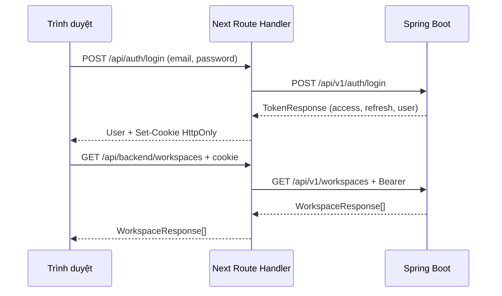

# Frontend — tài khoản, workspace và GitHub

Frontend tương ứng backend Phase 00–02. Có đăng ký, đăng nhập, duy trì phiên, đăng xuất, thông tin tài khoản/UUID, tạo/chuyển workspace, quản lý thành viên và danh sách repository/phân trang/đồng bộ GitHub. API workflow được bổ sung ở [Phase 03](phase-03.md); tài liệu frontend này chưa bao gồm màn hình workflow, incident hoặc AI.

## Chạy local

Yêu cầu Node.js 22+, npm, JDK 21 và Docker Desktop. Tại root, bật hạ tầng và backend:

```powershell
.\scripts\backend.ps1 -Task infra
.\scripts\backend.ps1 -Task run
```

Mở terminal thứ hai tại root:

```powershell
cd frontend
npm ci
npm run dev
```

Mở **http://127.0.0.1:3000**. Cấu hình mặc định trỏ tới backend **http://127.0.0.1:8080**. Không cần copy `.env` của backend sang frontend. Khi đổi port/hostname, tạo `frontend/.env.local` từ `frontend/.env.example` và sửa:

```dotenv
BACKEND_URL=http://127.0.0.1:8080
APP_ORIGIN=http://127.0.0.1:3000
```

`APP_ORIGIN` là origin chính xác của frontend, không có `/` cuối. Dùng thống nhất `127.0.0.1` hoặc `localhost`; chúng là hai origin/cookie host khác nhau. Thay đổi environment cần khởi động lại Next. Chỉ Next server gọi Spring, nên không cần nới CORS/Spring Security. Không cấu hình URL backend từ dữ liệu người dùng.

## Thử theo từng bước

1. Mở `/register`, đăng ký tài khoản. Tên tối đa 120 ký tự, email tối đa 320, mật khẩu ít nhất 12 ký tự và tối đa **72 byte UTF-8**. Mật khẩu được giữ nguyên, không trim hay cắt ngắn.
2. Khi đăng ký xong, form chuyển sang đăng nhập với email đã điền. Backend đăng ký chỉ trả user, chưa phát hành token.
3. Đăng nhập và tạo workspace bằng tên/slug. Slug chỉ gồm nhóm chữ thường/số, ngăn bằng `-`, tối đa 120 ký tự và không trùng. Người tạo có role OWNER.
4. Tạo tài khoản khác bằng trình duyệt/incognito khác. Người đó vào **Tài khoản**, sao chép UUID gửi cho OWNER/ADMIN. Người quản lý chọn **Thành viên → Thêm thành viên**; chưa có mời qua email hoặc tìm tài khoản theo email.
5. OWNER quản lý ADMIN/MEMBER; ADMIN chỉ thêm/xóa MEMBER; MEMBER chỉ xem. Không có giao diện đổi hoặc xóa OWNER. Backend vẫn kiểm tra quyền ở mỗi request, kể cả khi giao diện đang hiển thị dữ liệu cũ.
6. Vào **Kho mã**. Người vận hành cấu hình GitHub App/binding theo [Phase 02](phase-02.md), rồi OWNER chọn **Đồng bộ GitHub**. Tích hợp mặc định tắt; lỗi 503 hiển thị hướng xử lý. Không nhập key/token GitHub vào frontend.
7. Đăng xuất thu hồi refresh token hiện tại và xóa cookie của frontend. Nếu backend lỗi, giao diện báo chưa đăng xuất thành công để người dùng thử lại.

## Luồng dữ liệu và bảo vệ phiên



- `src/lib/contracts.ts` phản ánh DTO JSON. `src/lib/server/backend.ts` chỉ chạy server; các route auth tách token khỏi JSON trả cho browser. Spring không nhận cookie xác thực từ frontend.
- Access cookie `tp_access` có path `/api`, hạn theo `expiresIn` (backend hiện là 15 phút). Refresh cookie `tp_refresh` có path `/api/auth`, hạn 7 ngày theo `TokenService.REFRESH_TTL`. Cả hai là HttpOnly, SameSite=Lax, host-only; production bật Secure và cần HTTPS. Không lưu token vào localStorage/sessionStorage. localStorage chỉ giữ UUID workspace đã chọn theo từng user.
- Khi request cần xác thực trả 401, client gọi refresh rồi thử lại request **một lần**. Các request cùng tab dùng chung refresh đang chạy. Next server gom refresh đồng thời cùng token trong một process, giữ kết quả 5 giây để tránh hai tab tiêu thụ token single-use. Không tự refresh khi sai mật khẩu đăng nhập, lỗi mạng, 403 hoặc 404.
- **Giới hạn triển khai:** cơ chế gom refresh ở RAM chỉ dành cho một Next instance. Trước khi scale nhiều instance/serverless cần shared session/lock store hoặc thiết kế BFF session tập trung. Đây chưa phải bằng chứng production readiness. Rate limiting, password reset và email verification cũng chưa thuộc backend hiện tại.
- Mọi POST/PATCH/DELETE kiểm tra `Origin === APP_ORIGIN` và từ chối `Sec-Fetch-Site: cross-site`. Cookie SameSite bổ sung bảo vệ; kiểm tra origin áp dụng cả login/logout/refresh. Reverse proxy cần giữ Origin chuẩn và không public một origin phụ ngoài cấu hình.
- Proxy chỉ nhận các method/path workspace được liệt kê, UUID hợp lệ và query phân trang `page/size`. Không phải open proxy, không chuyển header Authorization/cookie do browser tự nhập sang backend. Auth data không cache, không log password/token; Playwright trace tắt vì có thể chứa cookie/request body.
- Backend vẫn giữ toàn bộ validation, transaction, khóa đồng thời, role và cách ly workspace. Không có thay đổi Java hoặc Flyway cho frontend này.

## Cấu trúc để đọc và học

```text
frontend/src/
  app/
    login/, register/              # Form tài khoản
    (dashboard)/                   # Tổng quan, members, repositories, account
    api/auth/[action]/             # Cookie phiên và auth API
    api/backend/[...path]/         # Proxy allowlist tới workspace API
    globals.css                    # Màu, bố cục và responsive
  components/
    auth-provider.tsx              # User hiện tại và trạng thái phiên
    workspace-provider.tsx         # Workspace hiện tại và membership/role
    workspace-boundary.tsx         # Loading/error/empty của workspace
    dashboard-shell.tsx            # Điều hướng và đăng xuất
    ui/                            # Button, Radix Dialog và thông báo trạng thái
  lib/
    contracts.ts                   # DTO TypeScript
    api.ts                         # Fetch, refresh một lần, lỗi tiếng Việt
    server/backend.ts              # Server-only: fetch Spring và cookie
```

Đọc theo một luồng: `auth-form.tsx` → `lib/api.ts` → `app/api/auth/[action]/route.ts` → `AuthController/AuthService` → `auth-provider.tsx`. Sau đó đọc `workspace-provider.tsx` và `members.tsx` cùng `WorkspaceService` để thấy vai trò frontend/backend trong kiểm tra quyền.

## Kiểm chứng

Tại `frontend/`:

```powershell
npm run typecheck
npm run build
npx playwright install chromium
npm run test:ui

# Cần backend thật đang chạy; tạo tài khoản/workspace thử trong DB local.
$env:TRACEPILOT_LIVE = '1'
npm run test:live
Remove-Item Env:TRACEPILOT_LIVE
```

`npm run test:e2e` chạy tất cả; live tests được skip nếu không bật biến trên. Playwright tự bật Next dev tại port 3000 nếu chưa có server. `FRONTEND_URL` đổi baseURL để dùng một frontend đã chạy sẵn; cấu hình `APP_ORIGIN` của server phải tương ứng.

UI fixture tests kiểm tra các trạng thái, quyền hiển thị, lỗi một phần, validation UTF-8, đổi workspace, bàn phím và responsive 1440/390/320 px. Live tests gọi Next/Spring thật để kiểm tra cookie, refresh đồng thời, logout, đăng ký, tạo workspace và cách ly quyền. Tài khoản `frontend-test-*`/`frontend-ui-*` và workspace thử được giữ trong database local; test không reset hoặc xóa dữ liệu đang có. Test report ở `frontend/playwright-report/`, ảnh ở `.verification/frontend/`; không đưa credential hoặc artifact riêng tư lên Git.

Kiểm thử backend tại root: `.\scripts\backend.ps1 -Task verify`. Build Next, TypeScript, browser test local, Maven test, IDE và triển khai là các mức bằng chứng khác nhau. GitHub App thật cần cấu hình và kiểm tra riêng theo Phase 02.

## Khắc phục lỗi

- Đăng nhập báo không kết nối được: kiểm tra `http://127.0.0.1:8080/actuator/health`, Docker và log backend; đối chiếu `BACKEND_URL` với port thật.
- POST trả 403 ở lớp Next: đối chiếu URL trình duyệt và `APP_ORIGIN`; kiểm tra có nhầm `localhost`/`127.0.0.1` không. Không tắt kiểm tra Origin để vượt lỗi.
- Đăng ký lỗi mật khẩu dù ít hơn 72 ký tự: giới hạn là byte UTF-8; tiếng Việt/emoji có thể dùng nhiều byte.
- Workspace/membership trả 404: tài khoản không còn quyền hoặc UUID sai. Tải lại danh sách workspace; không suy luận workspace tồn tại từ lỗi 404.
- Đồng bộ trả 503/409/502: xem [hướng dẫn GitHub](phase-02.md); frontend không tự tạo binding installation hoặc retry sync liên tục.
- Chạy production local: `npm run build`, `npm start`. Production đặt Secure cookie; dùng HTTPS khi triển khai và cấu hình origin public chính xác.
