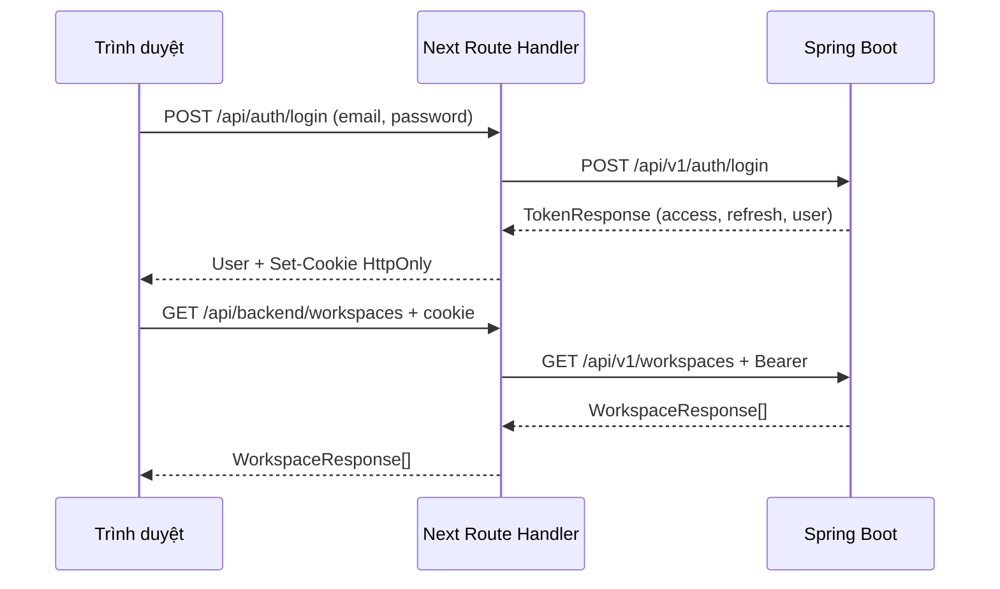

# Frontend — Clean Precision và luồng điều tra sự cố

Frontend có các luồng backend Phase 01–08: tài khoản, workspace/thành viên, repository, workflow run/jobs, incident/log đã che, thông báo/SSE, phân tích AI, kho kiến thức/RAG, Chất lượng AI và vận hành/audit. Giao diện bám `Design_TracePilot` và [hệ thống Clean Precision](../DESIGN.md): trắng/xanh băng, xanh dương cho thao tác, hồng cho điều tra/bằng chứng. Font Be Vietnam Pro và JetBrains Mono được tự host, không tải CDN khi mở ứng dụng.

Áp dụng hướng dẫn tinh giản và hoàn thiện từ [Impeccable](https://github.com/pbakaus/impeccable/tree/924bbd194d02e5e15a227e75b5901fb0d7a4ecad/.agents/skills/impeccable). Bản clone local ở `.tools/impeccable`; dùng context loader và detector trực tiếp, không cài hook toàn cục hay thêm Impeccable vào runtime sản phẩm.

## Chạy local

Nếu dùng stack shipping tại frontend 13000/backend 18081, DBeaver cần kết nối đúng [database shipping tại port 15433](database.md), dùng credential trong `.env.shipping`. Port 15432 thuộc database phát triển cũ và không tự chia sẻ dữ liệu với shipping.

Yêu cầu Node.js 22+, npm, JDK 21 và Docker Desktop. Tại root, bật hạ tầng và backend:

```powershell
.\scripts\backend.ps1 -Task infra
.\scripts\backend.ps1 -Task run
```

Mở terminal thứ hai tại root:

```powershell
cd frontend
npm ci
npm run dev
```

Mở **http://127.0.0.1:3000**. Cấu hình mặc định trỏ tới backend **http://127.0.0.1:8080**. Không cần copy `.env` của backend sang frontend. Khi đổi port/hostname, tạo `frontend/.env.local` từ `frontend/.env.example` và sửa:

```dotenv
BACKEND_URL=http://127.0.0.1:8080
APP_ORIGIN=http://127.0.0.1:3000
```

`APP_ORIGIN` là origin chính xác của frontend, không có `/` cuối. Dùng thống nhất `127.0.0.1` hoặc `localhost`; chúng là hai origin/cookie host khác nhau. Thay đổi environment cần khởi động lại Next. Chỉ Next server gọi Spring, nên không cần nới CORS/Spring Security. Không cấu hình URL backend từ dữ liệu người dùng.

## Thử theo từng bước

1. Mở `/register`, đăng ký tài khoản. Tên tối đa 120 ký tự, email tối đa 320, mật khẩu ít nhất 12 ký tự và tối đa **72 byte UTF-8**. Mật khẩu được giữ nguyên, không trim hay cắt ngắn.
2. Khi đăng ký xong, form chuyển sang đăng nhập với email đã điền. Backend đăng ký chỉ trả user, chưa phát hành token.
3. Đăng nhập và tạo workspace bằng tên/slug. Slug chỉ gồm nhóm chữ thường/số, ngăn bằng `-`, tối đa 120 ký tự và không trùng. Người tạo có role OWNER.
4. Tạo tài khoản khác bằng trình duyệt/incognito khác. Người đó vào **Tài khoản**, sao chép UUID gửi cho OWNER/ADMIN. Người quản lý chọn **Thành viên → Thêm thành viên**; chưa có mời qua email hoặc tìm tài khoản theo email.
5. OWNER quản lý ADMIN/MEMBER; ADMIN chỉ thêm/xóa MEMBER; MEMBER chỉ xem. Không có giao diện đổi hoặc xóa OWNER. Backend vẫn kiểm tra quyền ở mỗi request, kể cả khi giao diện đang hiển thị dữ liệu cũ.
6. Vào **Kho mã**. Người vận hành cấu hình GitHub App/binding theo [Phase 02](phase-02.md), rồi OWNER chọn **Đồng bộ GitHub**. Tích hợp mặc định tắt; lỗi 503 hiển thị hướng xử lý. Không nhập key/token GitHub vào frontend.
7. Đăng xuất thu hồi refresh token hiện tại và xóa cookie của frontend. Nếu backend lỗi, giao diện báo chưa đăng xuất thành công để người dùng thử lại.

## Luồng điều tra Phase 03–05

- **Tổng quan:** số kho mã, thành viên và tổng sự cố lấy từ API; sự cố và thông báo gần đây. Không suy diễn tỷ lệ thành công/metric 7 ngày khi chưa có API tổng hợp.
- **Lần chạy:** chọn repository trước, xem lịch sử/phân trang, mở đúng attempt và jobs. OWNER gửi GitHub run ID/attempt để xếp hàng đồng bộ; 202 chỉ xác nhận đã xếp hàng. Processing/publication status của yêu cầu tách riêng với kết quả CI.
- **Sự cố:** danh sách/phân trang và bộ lọc trạng thái trên trang hiện tại. Ba tab Tổng quan / Log đã che / Phân tích AI. OWNER/ADMIN được phân công và đổi trạng thái; MEMBER chỉ được đổi trạng thái hoặc yêu cầu AI khi đang phụ trách. Chỉ đưa ra các bước chuyển hợp lệ của backend.
- **Version:** PATCH trạng thái/phân công gửi version đã đọc. Khi 409, người dùng tải lại rồi quyết định lại; không tự gửi lại thay đổi bằng version mới. Đổi workspace ở màn hình chi tiết đưa về danh sách để tránh ghép ID cũ vào workspace mới.
- **Log:** chỉ đọc snippets đã lưu. Ghép đúng thứ tự để tìm chuỗi qua ranh giới đoạn; tìm kiếm/sao chép giữ nguyên văn bản. React hiển thị log/report như text, không thực thi HTML/script/lệnh. Có trạng thái chưa sẵn sàng/thất bại và hash nội dung đã che.
- **AI:** xác nhận việc gửi log tới nhà cung cấp và khả năng phát sinh chi phí. Tạo một requestId cho một thao tác, giữ lại khi retry; chỉ gửi sau xác nhận. Không tự bật AI/API key. Lịch sử/report, câu trích và usage theo attempt từ API. Usage/cost thiếu giữ là chưa có, không điền 0 hoặc tạo confidence giả. Câu trích mở đúng chuỗi trong tab log.
- **Thông báo:** dữ liệu của người đăng nhập trong workspace, phân trang và đánh dấu đã đọc. Next chuyển tiếp SSE với Bearer ở server; không đưa token vào URL. Reconnect giữ Last-Event-ID, kiểm tra/refresh phiên trước khi mở luồng. Mất kết nối vẫn có làm mới thủ công; dấu “Trực tiếp” chỉ hiện khi EventSource mở thành công.

Phase 07 thêm **đánh giá cá nhân** bên dưới báo cáo SUCCEEDED và trang **Chất lượng AI**: success rate, helpful rate, độ phủ review, latency, lý do đánh giá, lỗi và token/cost theo operation/model. Thành viên ACTIVE có thể chấm dù chưa được phân công; 409 yêu cầu tải lại phiếu. Xem [định nghĩa mẫu số và hướng dẫn thử](phase-07.md).

**Kho kiến thức Phase 06:** tạo bài hoặc ghi cách khắc phục từ sự cố RESOLVED, sửa bản nháp có version, OWNER/ADMIN duyệt và lưu trữ, tìm lỗi tương tự sau khi đồng ý gửi truy vấn tới AI. Báo cáo phân biệt nguồn log/knowledge và giữ thông tin revision lịch sử. Xem [luồng sử dụng, quyền và kiểm chứng](frontend-knowledge.md).

Xuất CSV thành viên, đổi tên/xóa/chuyển OWNER và sửa mã/tạo PR chưa được triển khai. Không tạo nút giả hoặc lấy dữ liệu minh họa làm dữ liệu sản phẩm. Tài khoản/workspace mới có trạng thái trống cho đến khi GitHub đã được cấu hình và gửi dữ liệu.

## Luồng dữ liệu và bảo vệ phiên

Phase 08 thêm **Vận hành & audit** cho OWNER/ADMIN: xem backlog/lịch sử tác vụ, xác nhận thử lại workflow/log theo quyền và xem audit có request ID. MEMBER không được tải các tài nguyên này; backend vẫn chặn request trực tiếp. Retry gửi replayCount đã đọc, 409 yêu cầu tải lại và quyết định lại; AI tạo phân tích mới thay vì reset lịch sử. Next giữ X-Request-ID và Retry-After hợp lệ từ backend, hiển thị thời gian chờ 429, không tự retry khi bị giới hạn. Xem [Phase 08](phase-08.md).



- `src/lib/contracts.ts` phản ánh DTO JSON. `src/lib/server/backend.ts` chỉ chạy server; các route auth tách token khỏi JSON trả cho browser. Spring không nhận cookie xác thực từ frontend.
- Access cookie `tp_access` có path `/api`, hạn theo `expiresIn` (backend hiện là 15 phút). Refresh cookie `tp_refresh` có path `/api/auth`, hạn 7 ngày theo `TokenService.REFRESH_TTL`. Cả hai là HttpOnly, SameSite=Lax, host-only; production bật Secure và cần HTTPS. Không lưu token vào localStorage/sessionStorage. localStorage chỉ giữ UUID workspace đã chọn theo từng user.
- Khi request cần xác thực trả 401, client gọi refresh rồi thử lại request **một lần**. Các request cùng tab dùng chung refresh đang chạy. Next server gom refresh đồng thời cùng token trong một process, giữ kết quả 5 giây để tránh hai tab tiêu thụ token single-use. Không tự refresh khi sai mật khẩu đăng nhập, lỗi mạng, 403 hoặc 404.
- **Giới hạn triển khai:** cơ chế gom refresh ở RAM chỉ dành cho một Next instance. Trước khi scale nhiều instance/serverless cần shared session/lock store hoặc thiết kế BFF session tập trung. Đây chưa phải bằng chứng production readiness. Rate limiting, password reset và email verification cũng chưa thuộc backend hiện tại.
- Mọi POST/PUT/PATCH/DELETE kiểm tra `Origin === APP_ORIGIN` và từ chối `Sec-Fetch-Site: cross-site`. Cookie SameSite bổ sung bảo vệ; kiểm tra origin áp dụng cả login/logout/refresh. Reverse proxy cần giữ Origin chuẩn và không public một origin phụ ngoài cấu hình.
- Proxy chỉ nhận các method/path workspace được liệt kê, UUID hợp lệ và query phân trang `page/size` hoặc `days` riêng cho quality. Không phải open proxy, không chuyển header Authorization/cookie do browser tự nhập sang backend. Auth data không cache, không log password/token; Playwright trace tắt vì có thể chứa cookie/request body.
- Backend giữ toàn bộ validation, transaction, khóa đồng thời, role và cách ly workspace. Feedback/dashboard cần API và migration V8 của [Phase 07](phase-07.md).

## Cấu trúc để đọc và học

```text
frontend/src/
  app/
    login/, register/              # Form tài khoản
    (dashboard)/                   # Tổng quan, repositories, runs, incidents, notifications, members, account
    api/auth/[action]/             # Cookie phiên và auth API
    api/backend/[...path]/         # Proxy allowlist tới workspace API
    globals.css                    # Màu, bố cục và responsive
  components/
    auth-provider.tsx              # User hiện tại và trạng thái phiên
    workspace-provider.tsx         # Workspace hiện tại và membership/role
    workspace-boundary.tsx         # Loading/error/empty của workspace
    dashboard-shell.tsx            # Điều hướng và đăng xuất
    realtime-provider.tsx          # SSE, reconnect và invalidation theo workspace
    incident-detail.tsx            # Lifecycle, phân công và ba tab
    log-viewer.tsx                 # Văn bản log, tìm kiếm và bằng chứng
    analysis-panel.tsx             # Consent, lịch sử, report và usage
    ui/                            # Button, Radix Dialog và thông báo trạng thái
  lib/
    contracts.ts                   # DTO TypeScript
    api.ts                         # Fetch, refresh một lần, lỗi tiếng Việt
    use-resource.ts                # GET, hủy request cũ và reload khi có SSE
    server/backend.ts              # Server-only: fetch Spring và cookie
```

Đọc theo một luồng: `auth-form.tsx` → `lib/api.ts` → `app/api/auth/[action]/route.ts` → `AuthController/AuthService` → `auth-provider.tsx`. Sau đó đọc `workspace-provider.tsx` và `members.tsx` cùng `WorkspaceService` để thấy vai trò frontend/backend trong kiểm tra quyền.

## Kiểm chứng

Tại `frontend/`:

```powershell
npm run typecheck
npm run format:check
npm run build
npx playwright install chromium
npm run test:ui

# Cần backend thật đang chạy; tạo tài khoản/workspace thử trong DB local.
$env:TRACEPILOT_LIVE = '1'
npm run test:live
Remove-Item Env:TRACEPILOT_LIVE
```

`npm run test:e2e` chạy tất cả; live tests được skip nếu không bật biến trên. Playwright tự bật Next dev tại port 3000 nếu chưa có server. `FRONTEND_URL` đổi baseURL để dùng một frontend đã chạy sẵn; cấu hình `APP_ORIGIN` của server phải tương ứng.

UI fixture tests kiểm tra trạng thái/quyền, lỗi một phần, validation UTF-8, đổi workspace, version 409, idempotency AI, bằng chứng qua hai đoạn log, log giống HTML và responsive/accessibility 1440/390/320 px. Live tests gọi Next/Spring thật để kiểm tra cookie, refresh/logout, tạo workspace, API Phase 03–05, SSE và cách ly quyền. Tài khoản `frontend-test-*`/`frontend-ui-*`/`frontend-operations-*` và workspace thử được giữ trong database đích; không reset/xóa dữ liệu đang có. Report ở `frontend/playwright-report/`, ảnh ở `.verification/redesign/` và `.verification/frontend/`; không đưa credential hay artifact riêng tư lên Git.

Khi cần kiểm chứng tách khỏi database local, dùng `TestTracePilotApplication` với `spring-boot:test-run` theo [Spring Boot Maven](https://docs.spring.io/spring-boot/maven-plugin/run.html). Class này tạo PostgreSQL/RabbitMQ riêng qua Testcontainers; dữ liệu của môi trường đó là tạm thời. Phải đặt JDK 21 trước, giữ AI/GitHub tắt khi chỉ thử UI. Đây không phải cách sửa database local lỗi migration.

Kiểm thử backend tại root: `.\scripts\backend.ps1 -Task verify`. Build Next, TypeScript, browser test local, Maven test, IDE và triển khai là các mức bằng chứng khác nhau. GitHub App thật cần cấu hình và kiểm tra riêng theo Phase 02.

Kết quả local của lần sửa Clean Precision: build/TypeScript đạt, **29 test frontend** (23 fixture UI + 6 tích hợp live) và **81 test backend của baseline Phase 05** đạt. Impeccable source detector trả 0 finding; axe trên dashboard/report tại ba viewport không có vi phạm theo các rule đã chạy. Report chi tiết local: `.verification/redesign/report.json`. Preview hiện dùng snapshot `7cce48c` và Testcontainers tại port 8080; dữ liệu preview là tạm thời. Không reset/sửa lịch sử database gốc; các live check ban đầu đã bổ sung tài khoản/workspace kiểm thử `frontend-*` vào database đó. Các file Phase 06 đang phát triển đồng thời không thuộc phạm vi xác nhận này.

## Khắc phục lỗi

- Đăng nhập báo không kết nối được: kiểm tra `http://127.0.0.1:8080/actuator/health`, Docker và log backend; đối chiếu `BACKEND_URL` với port thật.
- POST trả 403 ở lớp Next: đối chiếu URL trình duyệt và `APP_ORIGIN`; kiểm tra có nhầm `localhost`/`127.0.0.1` không. Không tắt kiểm tra Origin để vượt lỗi.
- Đăng ký lỗi mật khẩu dù ít hơn 72 ký tự: giới hạn là byte UTF-8; tiếng Việt/emoji có thể dùng nhiều byte.
- Workspace/membership trả 404: tài khoản không còn quyền hoặc UUID sai. Tải lại danh sách workspace; không suy luận workspace tồn tại từ lỗi 404.
- Đồng bộ trả 503/409/502: xem [hướng dẫn GitHub](phase-02.md); frontend không tự tạo binding installation hoặc retry sync liên tục.
- API mới trả 404 dù source có controller: kiểm tra tiến trình backend đã nạp code mới chưa. Nếu khởi động bị Flyway checksum mismatch, cần đối soát migration/schema trước; không repair hoặc reset chỉ để chạy UI. Database local được ghi nhận có V4 applied `-702013013` khác source `6650674`. Để kiểm chứng Phase 08 hiện tại, dùng `.\scripts\backend.ps1 -Task preview` tại root, đặt `BACKEND_URL=http://127.0.0.1:18080` cho Next và khởi động lại frontend; xem [hướng dẫn preview và live test](phase-08.md#preview-bằng-database-test-riêng). Snapshot Phase 05 nói trên chỉ là bằng chứng lịch sử.
- Chạy production local: `npm run build`, `npm start`. Production đặt Secure cookie; dùng HTTPS khi triển khai và cấu hình origin public chính xác.
