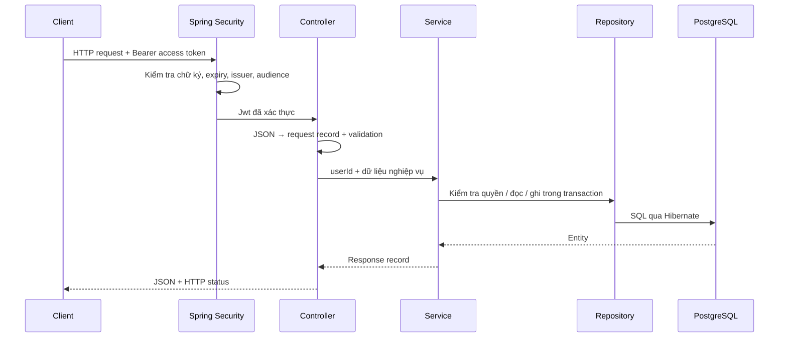

# Phase 01 — Users, Authentication & Workspace

Phase này trả lời hai câu hỏi: **bạn là ai** và **bạn được làm gì trong workspace này**.
Backend có API để đăng ký, đăng nhập, refresh/logout, tạo workspace và quản lý thành viên. Chưa có frontend, GitHub webhook hay AI.

## 1. Đọc mã theo luồng dữ liệu



- **Entity** (`User`, `RefreshToken`, `Workspace`, `WorkspaceMember`) ánh xạ dữ liệu với bảng PostgreSQL. Hibernate tạo entity khi đọc DB; service tạo entity khi thêm dữ liệu.
- **Record DTO** trong `AuthDtos`, `WorkspaceDtos` mô tả JSON vào/ra. Record chỉ giữ dữ liệu, không phải entity. Response không chứa password hash hoặc refresh token hash.
- **Controller** nhận HTTP, gọi service và trả status. Spring/Jackson tạo request record từ JSON; `@Valid` kiểm tra ràng buộc trước khi gọi nghiệp vụ.
- **Service** giữ quy tắc nghiệp vụ và transaction. Spring tạo các bean này, rồi truyền repository/dependency qua constructor; controller không tự `new AuthService(...)`.
- **Repository** là interface; Spring Data tạo implementation lúc khởi động. Hibernate chuyển thao tác repository thành SQL.
- `@Transactional` trên service khiến các thay đổi DB cùng thành công hoặc cùng rollback. Tạo workspace và membership OWNER là một transaction.

Thứ tự đọc gợi ý:

1. `identity/User.java` → `UserRepository.java` → các record trong `AuthDtos.java`.
2. `AuthController.register()` → `AuthService.register()` → `userRepository.saveAndFlush()`.
3. `AuthService.login()` → `TokenService` → `SecurityConfiguration`.
4. `RefreshTokenRepository.findForUpdate()` → `AuthService.refresh()`.
5. `WorkspaceController` → `WorkspaceService` → hai repository workspace.
6. `Phase01IntegrationTests` để xem request HTTP và các tình huống bị từ chối.

## 2. Bốn bảng và migration

| Bảng | Vai trò |
|---|---|
| `users` | Email không phân biệt hoa/thường, BCrypt password hash, tên hiển thị |
| `refresh_tokens` | SHA-256 của token ngẫu nhiên, hạn dùng, thời điểm revoke |
| `workspaces` | Không gian làm việc, slug unique, người tạo |
| `workspace_members` | Quan hệ user/workspace, role, trạng thái ACTIVE/REMOVED |

Migration mới là `V2__identity_and_workspaces.sql`. `V1__enable_pgvector.sql` của Phase 00 được giữ nguyên. Không chạy file tham khảo `V1__init.sql` ở root trên database này.

Khác biệt nhỏ so với SQL tham khảo: UUID và thời gian tạo được service/entity gán rõ ràng; `token_hash` là `VARCHAR(64)` có CHECK độ dài để khớp mapping Java. Unique index giới hạn tối đa một OWNER đang ACTIVE mỗi workspace. Các quy tắc cấp quyền còn lại nằm ở service.

## 3. Đăng nhập và token

- Đăng ký trả thông tin user; gọi login riêng để nhận token.
- Mật khẩu đăng ký từ 12 ký tự, tối đa 72 byte UTF-8 do giới hạn BCrypt; không tự cắt mật khẩu dài. Mật khẩu không được trim. BCrypt cost 12.
- Email được chuẩn hóa lowercase; unique index `lower(email)` bảo vệ cả khi có request đồng thời.
- Access token là JWT HS256, hạn **15 phút**. JWT chứa `sub=userId`, issuer, audience và `token_use=access`; không chứa role workspace.
- Refresh token là 32 byte ngẫu nhiên, mã hóa base64url thành 43 ký tự, hạn **7 ngày**. DB chỉ lưu SHA-256; refresh token không phải JWT.
- Refresh thành công thu hồi token cũ và cấp cặp token mới trong cùng transaction. Row lock làm hai request refresh cùng token chỉ có một request thành công.
- Logout thu hồi refresh token được gửi lên và có thể gọi lặp. Các phiên khác giữ nguyên. Access token đã phát hành vẫn có hiệu lực đến hết hạn 15 phút; Phase 01 chưa có danh sách thu hồi access token.
- Request có quyền dùng header `Authorization: Bearer <accessToken>`. Refresh/logout nhận refresh token trong JSON. API không dùng cookie xác thực hay HTTP session; CSRF được tắt cho cơ chế Bearer này. Nếu sau này chuyển sang cookie phải đánh giá lại CSRF.
- Client cần lưu token an toàn; phase này chưa quyết định cách lưu token cho frontend. Không đưa token vào URL, log hoặc mã nguồn.

JWT được xác minh bằng [Spring Security OAuth2 Resource Server](https://docs.spring.io/spring-security/reference/servlet/oauth2/resource-server/jwt.html). Ứng dụng tự phát hành token bằng `NimbusJwtEncoder`; phase này không dựng một OAuth authorization server.

## 4. Quyền workspace

| Thao tác | OWNER | ADMIN | MEMBER |
|---|---|---|---|
| Xem workspace / danh sách thành viên | Có | Có | Có |
| Thêm hoặc kích hoạt lại MEMBER | Có | Có | Không |
| Thêm ADMIN / đổi MEMBER ↔ ADMIN | Có | Không | Không |
| Xóa MEMBER khỏi workspace | Có | Có | Không |
| Xóa ADMIN khỏi workspace | Có | Không | Không |
| Cấp OWNER / sửa hoặc xóa OWNER | Không | Không | Không |

Người tạo tự thành OWNER. Chuyển quyền sở hữu và tự rời workspace chưa thuộc Phase 01. Thêm thành viên bằng `userId` của tài khoản đã đăng ký; chưa có gửi email mời.

Quyền được đọc từ membership ACTIVE trong DB ở mỗi request. Vì vậy token đang dùng mất quyền quản trị ngay sau khi bị hạ role, và mất quyền đọc workspace sau khi bị REMOVED. Các thao tác thay đổi thành viên khóa hàng workspace trước khi kiểm tra quyền để tránh đua với thao tác hạ quyền/xóa admin.

Người ngoài workspace nhận **404** khi truy cập workspace đó; thành viên có trong workspace nhưng thiếu quyền thao tác nhận **403**. Query danh sách chỉ trả workspace mà người gọi đang ACTIVE.

## 5. API

Tất cả đường dẫn dưới đây bắt đầu bằng `/api/v1`. Body là JSON.

| Method / path | Body | Kết quả thành công |
|---|---|---|
| `POST /auth/register` | `email`, `password`, `displayName` | 201, thông tin user |
| `POST /auth/login` | `email`, `password` | 200, access/refresh token + user |
| `POST /auth/refresh` | `refreshToken` | 200, cặp token mới + user |
| `POST /auth/logout` | `refreshToken` | 204 |
| `GET /auth/me` | — | 200, user hiện tại |
| `POST /workspaces` | `name`, `slug` | 201, workspace |
| `GET /workspaces` | — | 200, danh sách được phép xem |
| `GET /workspaces/{id}` | — | 200, workspace |
| `GET /workspaces/{id}/members` | — | 200, thành viên ACTIVE |
| `POST /workspaces/{id}/members` | `userId`, `role` | 201, membership |
| `PATCH /workspaces/{id}/members/{userId}` | `role` | 200, membership |
| `DELETE /workspaces/{id}/members/{userId}` | — | 204, đánh dấu REMOVED |

Register/login/refresh/logout và GET health là public. Những API nghiệp vụ khác cần Bearer access token. `role` phải là `OWNER`, `ADMIN` hoặc `MEMBER`, rồi còn phải qua kiểm tra quyền service. Slug chỉ nhận lowercase chữ/số và dấu `-` ngăn các nhóm.

Status lỗi: 400 dữ liệu không hợp lệ; 401 chưa xác thực/token không hợp lệ; 403 thiếu quyền trong workspace; 404 không tìm thấy hoặc không được xem; 409 dữ liệu trùng. Lỗi MVC dùng Problem Detail; lỗi xác thực từ filter có thể chỉ có status và header. Không dựa vào nội dung body của 401 để điều khiển client.

## 6. Chạy và thử từng bước

Tại root, bật Docker Desktop rồi chạy:

```powershell
.\scripts\backend.ps1 -Task infra
.\scripts\backend.ps1 -Task verify
.\scripts\backend.ps1 -Task run
```

Script bổ sung `AUTH_SIGNING_SECRET` ngẫu nhiên nếu `.env` đang thiếu biến này, giữ nguyên giá trị sẵn có. Không cần xóa volume. Khi backend chạy, Flyway áp dụng V2 lên database local đang ở V1.

Mở PowerShell khác, đăng ký tài khoản thử và đăng nhập. Dùng mật khẩu riêng cho tài khoản local này:

```powershell
$api = 'http://127.0.0.1:8080/api/v1'
$email = 'developer-' + [guid]::NewGuid().ToString('N') + '@example.com'
$password = Read-Host 'Mat khau local (it nhat 12 ky tu)' -AsSecureString
$credential = [pscredential]::new($email, $password)
$plain = $credential.GetNetworkCredential().Password

$user = Invoke-RestMethod "$api/auth/register" -Method Post -ContentType 'application/json' -Body (@{
    email = $email; password = $plain; displayName = 'Developer'
} | ConvertTo-Json)

$session = Invoke-RestMethod "$api/auth/login" -Method Post -ContentType 'application/json' -Body (@{
    email = $email; password = $plain
} | ConvertTo-Json)
Remove-Variable plain, credential

$headers = @{ Authorization = 'Bearer ' + $session.accessToken }
Invoke-RestMethod "$api/auth/me" -Headers $headers

$workspace = Invoke-RestMethod "$api/workspaces" -Method Post -Headers $headers -ContentType 'application/json' -Body (@{
    name = 'My team'; slug = 'team-' + [guid]::NewGuid().ToString('N')
} | ConvertTo-Json)
Invoke-RestMethod "$api/workspaces/$($workspace.id)/members" -Headers $headers

$oldRefresh = $session.refreshToken
$session = Invoke-RestMethod "$api/auth/refresh" -Method Post -ContentType 'application/json' -Body (@{
    refreshToken = $oldRefresh
} | ConvertTo-Json)
$headers = @{ Authorization = 'Bearer ' + $session.accessToken }

# Thu lai oldRefresh phai tra 401; chi dung token moi cho lan refresh tiep theo.
# Logout thu hoi refresh token moi:
Invoke-RestMethod "$api/auth/logout" -Method Post -ContentType 'application/json' -Body (@{
    refreshToken = $session.refreshToken
} | ConvertTo-Json)
```

Kết quả cần thấy: `/me` trả đúng user, membership đầu tiên là OWNER, refresh trả token khác, token refresh cũ và token đã logout bị từ chối. Không in `$session` ra log vì nó chứa token.

## 7. Kiểm chứng và tự luyện

`Phase01IntegrationTests` gửi HTTP đến server thật, dùng PostgreSQL/pgvector và RabbitMQ riêng qua Testcontainers; không mock auth hoặc database. Các test bao phủ hash, email trùng, JWT sai/hết hạn, refresh/logout, refresh đồng thời, tenant isolation, MEMBER tự nâng quyền, giới hạn ADMIN, bảo vệ OWNER và thu hồi quyền tức thời. `TracePilotApplicationTests` giữ kiểm tra health, migration và cosine distance của Phase 00.

Tự trả lời trước khi qua Phase 02:

1. Vì sao controller không trả thẳng entity `User`?
2. Nếu lưu refresh token rõ trong DB, việc lộ DB có hậu quả gì khác lưu hash?
3. Tại sao `findForUpdate()` phải chạy trong transaction? Nếu bỏ lock, hai refresh cùng lúc có thể xảy ra điều gì?
4. Vì sao JWT hợp lệ chưa đủ để đọc một workspace bất kỳ?
5. Nếu tạo workspace thành công nhưng ghi OWNER thất bại, transaction giúp gì?

Phạm vi hiện tại là backend local. Rate limiting, dọn token hết hạn, password reset/email verification và cơ chế thu hồi toàn bộ phiên chưa được triển khai ở phase này. Checklist hardening trước triển khai public thuộc phase sau; test local không chứng minh production hoặc CI.
