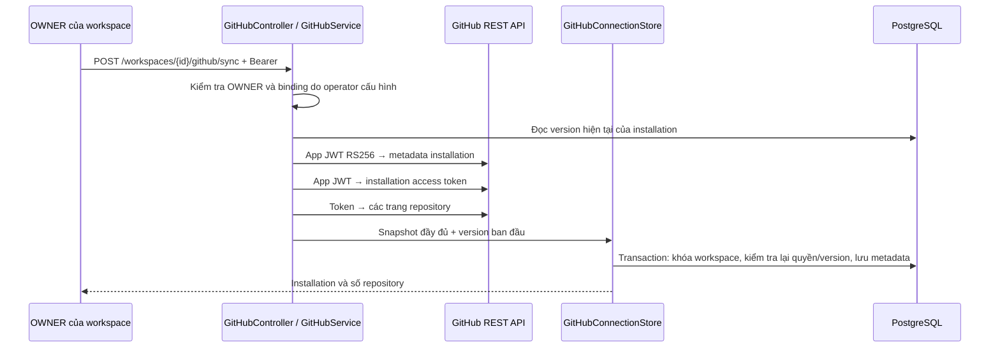
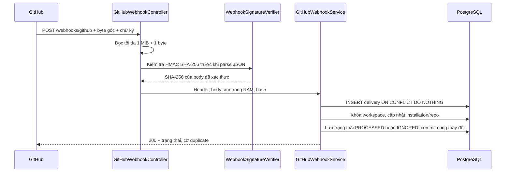

# Phase 02 — GitHub App và webhook an toàn

Phase này kết nối repository với workspace, đồng bộ danh sách repo qua GitHub REST API và nhận sự kiện đổi quyền của GitHub App. Workflow run/job, queue và incident thuộc Phase 03–04.

## 1. Hai luồng riêng





`GitHubApiClient` xử lý giao tiếp mạng. `GitHubConnectionStore` chỉ ghi DB sau khi toàn bộ snapshot đã tải xong, nên không giữ transaction/row lock trong lúc đợi mạng. `GitHubWebhookService` không gọi API bên ngoài trong request webhook.

## 2. Vì sao phải cấu hình binding?

`installation_id` là mã định danh, không phải bằng chứng sở hữu. Một API cho phép bất kỳ OWNER nào nhập installation ID rồi nhận repo có thể làm lộ dữ liệu giữa workspace.

MVP hiện dùng **một installation ↔ một workspace do người vận hành phê duyệt trong environment**. Request sync không nhận installation ID hoặc workspace binding từ JSON. OWNER chỉ đồng bộ đúng binding đã được cấu hình. Webhook `installation.created` không tự tạo liên kết.

Đây là luồng cài đặt có operator hỗ trợ. Chưa có màn hình OAuth tự phục vụ để người dùng gắn GitHub account/installation. Nếu cần luồng đó ở phase sau, phải xác minh quyền GitHub của người gắn installation; không thay kiểm tra này bằng việc biết ID.

## 3. Dữ liệu và các ràng buộc

Migration `V3__github_connections_and_webhooks.sql` tạo ba bảng:

| Bảng | Nội dung |
|---|---|
| `github_installations` | Workspace, installation ID bên GitHub, account login, trạng thái, version |
| `repositories` | Repo ID, full name, default branch nếu biết, active flag, workspace và installation |
| `webhook_deliveries` | Delivery ID unique, loại/action sự kiện, hash body, installation nội bộ nếu đã liên kết, trạng thái/thời gian |

- Composite FK `(installation_id, workspace_id)` ngăn repo liên kết vào installation của workspace khác.
- Version giúp phát hiện webhook hoặc sync khác vừa cập nhật installation trong lúc REST API đang tải. Snapshot cũ bị từ chối bằng 409; gọi sync lại để đọc trạng thái mới.
- Đồng bộ lại giữ ID nội bộ của repo đã biết. Repo không còn được cấp quyền trở thành `active=false`, không xóa lịch sử.
- Webhook selection có thể thiếu `default_branch`; DB để `NULL` cho đến khi REST sync đọc được giá trị thật, không tự đoán là `main`.
- DB không lưu private key, app JWT, installation token hoặc toàn bộ webhook payload. Delivery lỗi được rollback; redelivery cùng ID có thể thử lại.
- Schema delivery của phase này giữ những trường đang dùng. Trạng thái retry/worker, outbox và dữ liệu workflow sẽ được thêm bằng migration ở phase sau khi có luồng xử lý tương ứng.

## 4. Sự kiện được xử lý

| Event/action | Hành vi |
|---|---|
| `ping` | Xác thực, ghi metadata, trả PROCESSED |
| `installation_repositories` / `added`, `removed` | Thêm/kích hoạt repo được cấp quyền, vô hiệu hóa repo bị thu hồi |
| `installation_repositories` / `removed` không có ID bị xóa | Vô hiệu hóa repo hiện có, OWNER cần sync để biết selection mới |
| `installation` / `suspend` | SUSPENDED, vô hiệu hóa các repo |
| `installation` / `unsuspend` | ACTIVE, repo vẫn inactive cho đến khi OWNER sync lại |
| `installation` / `deleted` | REMOVED, vô hiệu hóa các repo; sự kiện unsuspend đến muộn không phục hồi installation đã xóa |
| Installation chưa liên kết hoặc event/action khác | Lưu metadata với IGNORED, không tự tạo kết nối |

Chỉ trả 200 sau khi transaction commit. Delivery trùng ID và cùng body/event trả `duplicate=true`; cùng ID nhưng khác body/event trả 409. Chống trùng bảo vệ delivery đã được xử lý thành công; không tuyên bố toàn hệ thống có exactly-once delivery.

GitHub có thể gửi sự kiện không theo thứ tự. Sync REST là cách đối soát lại trạng thái hiện tại; phase này chưa có tác vụ đối soát định kỳ. [GitHub troubleshooting](https://docs.github.com/en/webhooks/testing-and-troubleshooting-webhooks/troubleshooting-webhooks)

## 5. Chuẩn bị GitHub App thật

1. Tạo user/workspace qua Phase 01, ghi lại UUID workspace mà bạn là OWNER.
2. Trong GitHub **Settings → Developer settings → GitHub Apps**, tạo app cho môi trường này. Điền homepage URL phù hợp và webhook URL HTTPS trỏ đến `/webhooks/github` của backend. Localhost không nhận được webhook từ internet; cần endpoint/tunnel HTTPS cho môi trường dev. Chỉ public route webhook cần thiết.
3. Repository permissions: **Metadata: read** và **Actions: read**. GitHub App nhận sự kiện `installation` và `installation_repositories` mặc định; không cần tự đăng ký hai sự kiện này. Chưa cần đăng ký `workflow_run` cho đến Phase 03. [GitHub event reference](https://docs.github.com/en/webhooks/webhook-events-and-payloads#installation_repositories)
4. Tạo webhook secret ngẫu nhiên, ít nhất 32 ký tự. Dùng cùng một giá trị ở GitHub và `.env`, không đưa secret vào chat hoặc Git.
5. Generate private key của app, lưu file ngoài Git; cài app vào account/organization và chọn repo cần theo dõi. Ghi lại App ID và installation ID trong URL trang cài đặt installation.
6. Chuyển private key sang RSA PKCS#8 PEM nếu file tải về bắt đầu bằng `BEGIN RSA PRIVATE KEY`:

```text
openssl pkcs8 -topk8 -nocrypt -in github-app.pem -out github-app.pkcs8.pem
```

Lệnh cần OpenSSL có sẵn trong terminal đang dùng. Key đầu ra bắt đầu bằng `BEGIN PRIVATE KEY`. Giữ cả hai file riêng tư; không chép nội dung vào source. `.gitignore` đã bỏ qua `*.pem`, `*.key` và `.secrets/`.

Các hướng dẫn chính thức: [tạo app](https://docs.github.com/en/apps/creating-github-apps/registering-a-github-app/registering-a-github-app), [app JWT](https://docs.github.com/en/apps/creating-github-apps/authenticating-with-a-github-app/generating-a-json-web-token-jwt-for-a-github-app), [installation token](https://docs.github.com/en/apps/creating-github-apps/authenticating-with-a-github-app/authenticating-as-a-github-app-installation).

## 6. Cấu hình local và chạy thử

Thêm các biến sau vào `.env` đang có, giữ nguyên credential PostgreSQL/RabbitMQ và auth signing secret:

```dotenv
GITHUB_ENABLED=true
GITHUB_APP_ID=<app-id>
GITHUB_INSTALLATION_ID=<installation-id>
GITHUB_WORKSPACE_ID=<uuid-workspace-da-tao>
GITHUB_PRIVATE_KEY_PATH=F:/private/tracepilot/github-app.pkcs8.pem
GITHUB_WEBHOOK_SECRET=<secret-giong-tren-github-it-nhat-32-ky-tu>
```

Đây là placeholder, phải thay bằng giá trị thật. Đường dẫn key nên là absolute và dùng `/` vì `.env` được Spring đọc theo cú pháp `.properties`; dấu `\` trong đường dẫn Windows có thể bị hiểu thành escape. Tích hợp mặc định tắt; khi tắt, webhook/sync trả 503 thay vì dùng secret mẫu.

```powershell
.\scripts\backend.ps1 -Task infra
.\scripts\backend.ps1 -Task verify
.\scripts\backend.ps1 -Task run
```

Đăng nhập như Phase 01 để có `$session`, rồi dùng:

```powershell
$api = 'http://127.0.0.1:8080/api/v1'
$workspaceId = '<uuid-workspace-da-cau-hinh>'
$headers = @{ Authorization = 'Bearer ' + $session.accessToken }

# OWNER tải metadata thật từ installation đã được operator phê duyệt:
Invoke-RestMethod "$api/workspaces/$workspaceId/github/sync" -Method Post -Headers $headers

# Mọi thành viên ACTIVE được xem repo trong workspace:
Invoke-RestMethod "$api/workspaces/$workspaceId/repositories?page=0&size=20" -Headers $headers
```

Kỳ vọng sync trả `installationId`, `accountLogin`, `status`, `repositoryCount`. Danh sách trả `items`, `page`, `size`, `totalElements`; `size` giới hạn 1–100. HTTP 404 khi không phải thành viên workspace; 403 nếu có membership nhưng không phải OWNER để sync; 409 khi binding/version xung đột; 502 khi GitHub API thất bại; 503 khi chưa cấu hình tích hợp/key.

Sau khi sync thành công, thêm/bỏ repo trong GitHub App installation hoặc suspend app rồi xem Recent deliveries trên GitHub và trạng thái repo trong API. Gửi lại cùng delivery cần nhận `duplicate=true`, không thêm dòng repo/delivery trùng. Đây là bước kiểm chứng repo thật, khác với fixture local.

## 7. Giới hạn và phục hồi lỗi

- Webhook tối đa **1 MiB**, trả 413 nếu vượt giới hạn. HMAC dùng byte gốc và so sánh constant-time trước khi parse JSON. [GitHub signature validation](https://docs.github.com/en/webhooks/using-webhooks/validating-webhook-deliveries)
- Mỗi webhook selection tối đa 1000 thay đổi repo để chặn một request tạo số thao tác DB không giới hạn.
- Sync lấy tối đa **1000 repo**, mỗi trang 100. Nếu snapshot thiếu/trùng, count thay đổi giữa các trang hoặc API trả lỗi, không ghi đè dữ liệu hiện có bằng kết quả một phần.
- GitHub API dùng connect/request timeout 5 giây, response tối đa 4 MiB, không theo redirect. GET thử tối đa ba lần khi lỗi mạng/5xx; không tự lặp 403/429 hoặc POST tạo token. Sync lớn có thể kéo dài qua nhiều request; phase này là thao tác thủ công, chưa phải pipeline worker.
- App JWT sống tối đa 9 phút kể từ lúc tạo, `iat` lùi 60 giây để chịu lệch đồng hồ. Installation token chỉ ở RAM trong một lần sync; lần sync sau tạo token mới. Không cache token khi chưa có nhu cầu gọi API thường xuyên.
- Khi tạo installation token, backend yêu cầu đúng `Metadata: read` và `Actions: read`, kể cả khi app đã được cấp thêm quyền khác.
- Nếu key ở định dạng PKCS#1, đọc nhầm đường dẫn hoặc GitHub chưa cấp quyền, kiểm tra cấu hình thay vì sửa DB.
- GitHub **không tự gửi lại** delivery thất bại. Sửa lỗi rồi dùng Recent deliveries → Redeliver, hoặc đối soát bằng sync. Chưa có lịch tự redeliver trong phase này. [GitHub redelivery](https://docs.github.com/en/webhooks/testing-and-troubleshooting-webhooks/redelivering-webhooks)

## 8. Đọc code và kiểm thử

Thứ tự đọc: `GitHubController` → `GitHubService` → `GitHubApiClient`/`GitHubAppTokenSigner` → `GitHubConnectionStore`; sau đó `GitHubWebhookController` → `WebhookSignatureVerifier` → `GitHubWebhookService` → `WebhookDeliveryRepository`.

`Phase02IntegrationTests` chạy server Spring Boot thật, PostgreSQL/pgvector và RabbitMQ thật trong Testcontainers. `GitHubApiFixture` là HTTP server local thay cho GitHub: nó kiểm tra chữ ký RSA của app JWT, installation token và phân trang. Các test bao phủ chữ ký webhook/Unicode/byte bị sửa, metadata-only, delivery trùng và đồng thời, quyền workspace, lifecycle, lỗi/retry/partial response và sync đua với webhook suspend.

Các test Phase 00–01 vẫn chạy. Migration được kiểm tra từ database mới và từ V1 → V2 → V3. Kết quả này chứng minh tích hợp local với provider giả lập, chưa chứng minh GitHub App/repo thật hoặc triển khai public hoạt động.
