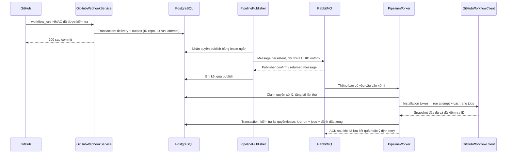

# Phase 03 — Workflow run/job và worker RabbitMQ

Phase này đưa dữ liệu GitHub Actions vào TracePilot: nhận `workflow_run`, tải run/jobs của đúng attempt, lưu lịch sử và cung cấp API cho dashboard. Phần triển khai và kiểm chứng ở đây là backend/API. Frontend tài khoản/workspace/GitHub có tài liệu riêng tại [frontend.md](frontend.md); giao diện workflow, SSE và incident không thuộc phần kiểm chứng này.

## 1. Run, job và attempt khác nhau thế nào?

- **Workflow run**: một lần GitHub chạy file workflow, ví dụ `CI`.
- **Job**: một công việc trong run, ví dụ `test` hoặc `build`.
- **Run attempt**: lần chạy lại của cùng run. Re-run có thể giữ nguyên GitHub run ID nhưng tăng `run_attempt`.

Ví dụ: run `7000`, attempt 1 thất bại; chạy lại thành attempt 2. TracePilot lưu hai dòng run riêng và gắn jobs vào đúng dòng, giữ kết quả lần trước.

**Một workflow thất bại vẫn có thể được đồng bộ thành công.** `conclusion=failure` là kết quả CI; `processingStatus=SUCCEEDED` nghĩa là worker đã lấy và lưu dữ liệu thành công. `processingStatus=FAILED` là lỗi đồng bộ dữ liệu, không phải lỗi build của repository.

## 2. Luồng dữ liệu và ai gọi ai



Spring tạo controller/service/repository như Phase 01. `@Scheduled` gọi publisher định kỳ; Spring AMQP gọi method có `@RabbitListener` khi broker giao message. RabbitMQ không tự biết cách đọc log hoặc phân tích CI; phần nghiệp vụ nằm trong Java worker.

Webhook không chờ GitHub REST API. Các lời gọi GitHub diễn ra trước transaction lưu snapshot, giúp request webhook phản hồi nhanh và tránh giữ DB lock khi chờ mạng.

## 3. Vì sao có outbox?

Nếu ghi DB xong rồi gửi thẳng RabbitMQ, tiến trình có thể chết giữa hai thao tác. Khi đó webhook đã được nhận nhưng công việc bị mất.

Phase này ghi **delivery và outbox trong cùng transaction**. Publisher lấy yêu cầu từ DB rồi gửi broker. Broker chưa hoạt động hoặc message không có binding sẽ khiến outbox tiếp tục chờ retry. Một message gửi lặp vẫn trỏ về cùng UUID outbox.

Migration `V4__pipeline_ingestion_and_outbox.sql` tạo:

| Bảng | Vai trò |
|---|---|
| `workflow_runs` | Metadata run của từng attempt; unique `(repository_id, github_run_id, run_attempt)` |
| `workflow_jobs` | Job của đúng run nội bộ; unique `(workflow_run_id, github_job_id)` |
| `outbox_events` | Yêu cầu nhỏ, trạng thái publish/xử lý, retry, thời gian và lease |

Outbox chỉ chứa internal repo ID, GitHub run ID và attempt. Rabbit message chỉ chứa UUID. Không lưu nguyên webhook payload, access token, private key, logs hoặc JSON response đầy đủ của GitHub.

## 4. Hai nhóm trạng thái của yêu cầu đồng bộ

`publicationStatus` cho biết việc đưa thông báo đến broker:

```text
PENDING → PUBLISHING → PUBLISHED
             ↓ lỗi
          PENDING + backoff
```

`processingStatus` cho biết việc lấy và lưu dữ liệu:

```text
PENDING / RETRY → RUNNING → SUCCEEDED
                    ├──→ IGNORED (repo/installation không còn được phép)
                    └──→ RETRY + backoff → FAILED khi hết lượt thử
```

- Mặc định tối đa **3 lần worker thực hiện yêu cầu**, có backoff 2 giây rồi 4 giây. Mỗi HTTP GET bên trong có retry riêng tối đa ba lần như Phase 02; không nhầm số lần HTTP với số lần worker.
- Khi FAILED, DB ghi ý định chuyển thông báo vào DLQ; publisher gửi đến `tracepilot.pipeline.sync.dead` và chờ confirm. Nếu broker còn lỗi, ý định này vẫn nằm trong DB để gửi tiếp.
- Broker outage không có hạn chót làm mất dữ liệu: publisher retry với delay tăng dần, chặn ở 30 giây. Tình trạng kéo dài cần người vận hành kiểm tra.
- Hai worker, mỗi worker prefetch một message. Một UUID đã RUNNING hoặc kết thúc sẽ không được xử lý lại bởi message trùng.
- Lease publish 30 giây; lease worker mặc định 5 phút. Lease hết hạn cho phép khôi phục tiến trình đã chết. Token lease ngăn worker cũ ghi kết quả sau khi công việc đã được nhận lại.
- Nếu đã publish nhưng không có worker nhận quá thời gian lease, DB sẽ cho gửi lại thông báo. Đây là **at-least-once notification**, được bảo vệ bằng claim và khóa unique; không phải exactly-once delivery toàn hệ thống.

Publisher confirm và consumer ACK giải quyết hai ranh giới khác nhau: broker đã nhận message, và ứng dụng đã xử lý message. [RabbitMQ acknowledgements/confirms](https://www.rabbitmq.com/docs/confirms), [Spring AMQP confirms/returns](https://docs.spring.io/spring-amqp/reference/amqp/connections.html)

## 5. Giữ đúng dữ liệu và quyền

- Chỉ nhận run từ repo ACTIVE trong installation đã được operator gắn đúng workspace. Không tự tạo repo từ dữ liệu webhook.
- Worker gọi endpoint **run attempt** và **jobs của attempt đó**. ID run, attempt và repository trong response phải khớp yêu cầu. Jobs không được trộn từ lần rerun khác. [Run attempts](https://docs.github.com/en/rest/actions/workflow-runs#get-a-workflow-run-attempt), [Jobs](https://docs.github.com/en/rest/actions/workflow-jobs#list-jobs-for-a-workflow-run-attempt)
- Jobs được phân trang 100/trang, tối đa 1000. Count không khớp, ID trùng, sai attempt hoặc thiếu trang sẽ làm snapshot thất bại; DB không nhận kết quả một phần.
- Trước khi commit, khóa workspace và kiểm tra lại repo/installation cùng version. Nếu quyền bị thu hồi trong lúc tải dữ liệu, worker không ghi snapshot. Nếu nguồn đổi nhưng vẫn hợp lệ, worker retry với thông tin mới.
- Snapshot có `source_updated_at` cũ hơn bị bỏ qua; run/job đã completed không bị đưa về queued/in_progress. Rerun dùng attempt mới.
- Jobs đã biết được giữ làm lịch sử, không bị xóa chỉ vì một snapshot sau không liệt kê chúng.
- Trường thời gian chỉ lấy từ metadata tương ứng. Nếu API không trả `completed_at` của run, `completedAt` để `null`; không dùng `updated_at` để giả định thời điểm hoàn tất.
- Thành viên ACTIVE xem lịch sử trong workspace. OWNER mới được yêu cầu đồng bộ thủ công. Người ngoài workspace hoặc truy cập run qua repo khác nhận 404.

## 6. API

Prefix chung:

```text
/api/v1/workspaces/{workspaceId}/repositories/{repositoryId}/workflow-runs
```

`repositoryId`, `runId` trong URL là UUID nội bộ TracePilot. GitHub run ID chỉ truyền trong body yêu cầu sync.

| Method / suffix | Kết quả |
|---|---|
| `GET ?page=0&size=20` | Danh sách các attempt, mới nhận trước |
| `GET /{runId}` | Chi tiết một attempt |
| `GET /{runId}/jobs` | Jobs của attempt đó |
| `GET /sync-requests?page=0&size=20` | Trạng thái publish/processing, attempts và error code cố định |
| `POST /sync` | OWNER gửi `{ "githubRunId": 7000, "runAttempt": 1 }`, trả 202 và yêu cầu mới |

`size` giới hạn 1–100. Mỗi lần sync thủ công tạo một yêu cầu mới, thích hợp cho backfill hoặc thử lại sau khi sửa lỗi; lịch sử yêu cầu FAILED và bản sao trong DLQ được giữ để kiểm tra.

## 7. Chạy với GitHub Actions thật

Trước hết hoàn tất cấu hình GitHub App và sync repo theo [Phase 02](phase-02.md). Phase 03 không thay thế việc này.

1. Cấp **Actions: read**, **Metadata: read** và đăng ký sự kiện **Workflow runs** cho GitHub App. Phê duyệt thay đổi permission trong installation nếu GitHub yêu cầu.
2. Bật webhook HTTPS đến `/webhooks/github`, dùng đúng secret đã cấu hình local.
3. `GITHUB_ENABLED=true` sẽ bật pipeline mặc định. Có thể đặt `PIPELINE_ENABLED=false` để tạm dừng publisher/worker mà vẫn lưu outbox từ webhook; bật lại để xử lý phần đang chờ.
4. Chạy hạ tầng và backend:

```powershell
.\scripts\backend.ps1 -Task infra
.\scripts\backend.ps1 -Task verify
.\scripts\backend.ps1 -Task run
```

Repo có workflow mẫu `.github/workflows/tracepilot-demo.yml`, chỉ chạy khi bạn chọn **Run workflow**. Sau khi file có trên default branch của repo đã kết nối, mở Actions → TracePilot ingestion demo → Run workflow. Chọn `fail=true` để tạo CI thất bại; workflow này không build/deploy ứng dụng.

Sau đó chọn **Re-run jobs** cho run đó. GitHub giữ run ID và tăng attempt; API TracePilot phải hiện thêm dòng attempt. Muốn một run thành công riêng, Run workflow lần mới với `fail=false`.

Không có thao tác dispatch workflow, push hoặc deploy nào được thực hiện tự động khi triển khai code phase này. Bằng chứng chạy mẫu trên GitHub cần thu riêng sau khi đã cấu hình app/repo.

## 8. Xem kết quả bằng PowerShell

Đăng nhập như Phase 01 để có `$session`, rồi:

```powershell
$api = 'http://127.0.0.1:8080/api/v1'
$workspaceId = '<uuid-workspace>'
$repositoryId = '<uuid-repository-tu-api-phase-02>'
$headers = @{ Authorization = 'Bearer ' + $session.accessToken }
$runsUrl = "$api/workspaces/$workspaceId/repositories/$repositoryId/workflow-runs"

Invoke-RestMethod "$runsUrl`?page=0&size=20" -Headers $headers
Invoke-RestMethod "$runsUrl/sync-requests" -Headers $headers

# Backfill hoặc thử lại bằng run ID lấy từ GitHub Actions:
$request = Invoke-RestMethod "$runsUrl/sync" -Method Post -Headers $headers -ContentType 'application/json' -Body (@{
    githubRunId = 7000; runAttempt = 1
} | ConvertTo-Json)

# Sau khi worker hoàn thành, lấy UUID run từ danh sách:
$runs = Invoke-RestMethod $runsUrl -Headers $headers
if ($runs.items.Count -gt 0) {
    $runId = $runs.items[0].id
    Invoke-RestMethod "$runsUrl/$runId/jobs" -Headers $headers
}
```

Không cần gọi sync thủ công sau mỗi webhook. Nếu không thấy dữ liệu, kiểm tra `sync-requests` trước: PENDING có thể do broker/worker đang tắt; RETRY đang chờ thử lại; FAILED cần kiểm tra cấu hình GitHub, repo rename, permission, network hoặc giới hạn snapshot. Source-delivery được chống trùng nên gửi lại một delivery đã nhận sẽ không tạo thêm yêu cầu; dùng POST `/sync` khi cần một lần đối soát mới.

RabbitMQ Management local ở port đã cấu hình trong Phase 00. Queue `tracepilot.pipeline.sync` nhận thông báo; `tracepilot.pipeline.sync.dead` giữ thông báo thất bại. Message chỉ có UUID để đối chiếu với `sync-requests`; xử lý lại bằng yêu cầu sync mới sau khi sửa nguyên nhân, không tạo vòng requeue vô hạn từ DLQ.

## 9. Kiểm chứng local và phạm vi còn lại

`Phase03IntegrationTests` dùng PostgreSQL/pgvector và RabbitMQ thật trong Testcontainers, HTTP GitHub fixture kiểm tra RSA/token. Các ca bao phủ:

- Webhook → outbox → broker → worker → API đọc run/jobs.
- Phân trang jobs, attempt riêng, webhook/message trùng và snapshot cũ.
- Rollback delivery lỗi, quyền workspace và repo bị thu hồi trong lúc tải.
- Retry giới hạn, DLQ thật, worker lease hết hạn.
- Binding bị mất và broker `stop_app/start_app` trong container test: yêu cầu đã nhận vẫn được xử lý sau phục hồi.

Các phase cũ và migration database mới/V1 → V2 → V3 → V4 đều được kiểm tra. Fixture local chứng minh luồng backend với provider giả lập. Nó chưa chứng minh webhook/GitHub Actions thật, dashboard Next.js hoặc triển khai public đã hoạt động. Logs, incident và SSE thuộc Phase 04; AI thuộc các phase sau.
