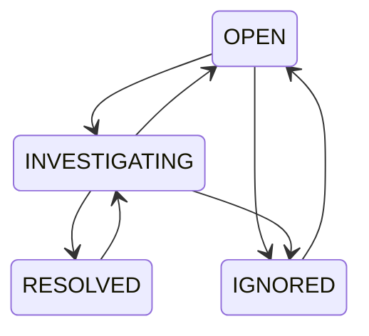

# Phase 04 — Incident, log đã che dữ liệu nhạy cảm và SSE

Phase này triển khai backend/API. Frontend hiện có màn hình Phase 01–02; giao diện incident chưa được bổ sung trong phase này. AI và gửi log cho nhà cung cấp AI thuộc Phase 05.

## 1. Incident được tạo lúc nào?

Một run attempt hoàn tất với `failure`, `timed_out` hoặc `startup_failure` tạo một incident OPEN. `success`, `cancelled`, `skipped` không tạo incident. Rerun có attempt khác, tương ứng workflow run nội bộ khác.

```mermaid
sequenceDiagram
    participant Worker as PipelineWorker
    participant Store as PipelineSyncStore
    participant DB as PostgreSQL
    participant MQ as RabbitMQ
    participant Logs as IncidentLogWorker
    participant GH as GitHub
    Worker->>Store: Snapshot run + jobs đã kiểm tra
    Store->>DB: Khóa workspace, kiểm tra lease/quyền
    Store->>DB: Lưu run/jobs + incident + notifications + outbox log
    Note over Store,DB: Cùng một transaction; unique workflow_run_id
    DB-->>MQ: Publisher gửi UUID outbox sau commit
    MQ->>Logs: Yêu cầu lấy log
    Logs->>GH: Tải plain text của job thất bại
    Logs->>Logs: Che dữ liệu nhạy cảm trước khi chia đoạn
    Logs->>DB: Transaction kiểm tra lại scope/lease, lưu snippets + notification
```

Spring gọi `PipelineWorker` khi có message. Worker gọi `PipelineSyncStore`; store gọi `IncidentRecorder` trong transaction đang có. Không gọi GitHub khi đang giữ DB lock.

- `UNIQUE(workflow_run_id)` và khóa workspace chống tạo trùng khi sync/webhook/message lặp.
- Chọn job thất bại có GitHub job ID nhỏ nhất làm job đại diện; MVP lưu một incident và log của một job cho mỗi attempt.
- Run thất bại nhưng không có job thất bại trong metadata vẫn tạo incident. Log trả `UNAVAILABLE`, không đoán job.
- Run thành công sau đó không tự đóng incident cũ. Người có quyền xác nhận trạng thái.
- Title incident là chuỗi cố định kèm run ID/attempt, không sao chép nội dung log hoặc tên workflow vào notification.

Migration không backfill các run thất bại đã nhập trước Phase 04. OWNER có thể gọi POST `workflow-runs/sync` của Phase 03 với GitHub run ID/attempt cũ; lần đồng bộ hợp lệ tiếp theo sẽ tạo incident còn thiếu.

Migration mới `V5__incidents_safe_logs_and_notifications.sql` tạo ba bảng. V1–V4 được giữ nguyên. Composite FK giữ đúng workspace → repository → run → job; snippet chỉ liên kết job đại diện của incident.

## 2. Đổi trạng thái, phân công và version



- OWNER/ADMIN đổi trạng thái và phân công cho thành viên ACTIVE cùng workspace.
- MEMBER xem incident/log; chỉ đổi trạng thái incident đang phân công cho mình.
- `assignedTo: null` nghĩa là bỏ phân công. Thành viên bị xóa mất quyền truy cập, kể cả khi tên còn trong lịch sử phân công.
- Người ngoài workspace hoặc URL ghép incident của workspace khác nhận 404.
- `resolvedAt` chỉ có khi RESOLVED; mở lại xóa thời điểm đó.
- Severity mặc định MEDIUM; chưa có thuật toán suy luận mức độ hoặc error fingerprint.

Mỗi lần đọc incident có `version`. Ví dụ hai người cùng đọc version 0: người thứ nhất ghi thành version 1; yêu cầu còn giữ version 0 nhận **409**, phải đọc lại trước khi quyết định. Code thực hiện optimistic locking bằng `UPDATE ... WHERE id = ? AND version = ?` rồi tăng version. Khóa workspace còn phối hợp với thao tác đổi quyền thành viên. Không cần thêm entity JPA chỉ để thực hiện phép cập nhật này.

Gửi lại trạng thái/phân công hiện tại với version còn đúng trả kết quả hiện tại, không tăng version hoặc tạo notification trùng. OPEN → RESOLVED trực tiếp bị từ chối; phải chuyển INVESTIGATING trước.

## 3. Log đi qua những bước nào?

1. Dùng installation token với Actions/Metadata read gọi endpoint job logs.
2. GitHub trả 302 và URL tải có chữ ký. Client chỉ nhận HTTPS từ host con của `blob.core.windows.net` hoặc `actions.githubusercontent.com`; không tự theo redirect tiếp.
3. Tải URL đó bằng request **không có Authorization**. URL ký và token chỉ ở bộ nhớ, không đưa vào DB, notification, response lỗi hoặc application log.
4. Giới hạn mỗi response **1 MiB**, deadline **5 giây cho cả body**. Dữ liệu quá lớn, UTF-8 lỗi, nội dung có NUL hoặc status không hợp lệ làm capture thất bại; không lưu phần raw bị cắt.
5. Chuẩn hóa Unicode/ANSI/control, che private-key PEM, header Authorization/Cookie, secret assignments, URL user/password, các định dạng token phổ biến; che thêm secret cấu hình ứng dụng và installation token tạm thời cùng một số biến thể mã hóa.
6. Chỉ sau redaction mới giữ tối đa **32.768 ký tự cuối**, chia đoạn tối đa 4.096 ký tự, tính SHA-256 trên **nội dung đã che** và lưu DB.

Giới hạn 32.768 dùng đơn vị UTF-16 của Java; tránh cắt giữa surrogate pair. Đoạn cuối thường chứa lỗi build, nhưng thông tin đầu log có thể bị bỏ. Không lưu full raw logs, file ZIP, signed source URL hoặc hash của raw log.

Log API của GitHub trả plain text theo từng job và URL hết hạn sau một phút. [GitHub job logs API](https://docs.github.com/en/rest/actions/workflow-jobs#download-job-logs-for-a-workflow-run)

**Phạm vi redaction:** các mẫu trên và known secrets được kiểm thử; không thể bảo đảm nhận ra mọi secret tùy ý, secret bị chia nhỏ hoặc biến đổi bằng cách mã hóa chưa biết. Workflow vẫn phải quản lý secrets đúng cách và dùng `::add-mask::` với giá trị nhạy cảm tự sinh. Không dùng kết quả phase này làm cam kết “không bao giờ rò secret”. [GitHub secure use reference](https://docs.github.com/en/actions/reference/security/secure-use)

Queue `tracepilot.incident.logs` dùng outbox, publisher confirm, processing lease, retry/backoff và DLQ chung `tracepilot.pipeline.sync.dead`. Mặc định tối đa ba lần capture; lỗi lưu mã cố định `GITHUB_LOG_CAPTURE_FAILED`. Incident vẫn tồn tại nếu log lỗi. Trước commit, worker kiểm tra lại installation/repo/version và job của incident; nguồn đã bị thu hồi trả IGNORED.

Log response có `status`: READY khi đã lưu snippets; UNAVAILABLE khi không có job đại diện; PENDING/RUNNING/RETRY/FAILED/IGNORED phản ánh capture outbox. Phase này chưa có API yêu cầu capture lại sau FAILED; sync run lại giữ incident/outbox cũ, không tạo vòng retry vô hạn. Chưa có retention tự động cho snippets/notifications.

## 4. API

Mọi endpoint dưới đây dùng Bearer access token; prefix:

```text
/api/v1/workspaces/{workspaceId}
```

| Method / đường dẫn | Ý nghĩa |
|---|---|
| GET /incidents?page=0&size=20 | Danh sách incident của workspace |
| GET /incidents/{incidentId} | Chi tiết, người được giao và version |
| PATCH /incidents/{incidentId}/status | `{"status":"INVESTIGATING","version":0}` |
| PATCH /incidents/{incidentId}/assignee | `{"assignedTo":"user-uuid","version":0}`; null để bỏ giao |
| GET /incidents/{incidentId}/logs | Trạng thái capture và các đoạn đã che |
| GET /notifications?page=0&size=20 | Chỉ notification của người đang đăng nhập |
| PATCH /notifications/{notificationId}/read | Đánh dấu đã đọc, trả 204; gọi lại vẫn 204 |
| GET /notifications/stream | SSE; header Last-Event-ID tùy chọn |

Pagination: page 0–10.000, size 1–100. ID trong URL là UUID nội bộ.

Ví dụ sau khi đăng nhập như [Phase 01](phase-01.md):

```powershell
$base = "http://127.0.0.1:8080/api/v1/workspaces/$workspaceId"
$headers = @{ Authorization = 'Bearer ' + $session.accessToken }
$incidents = Invoke-RestMethod "$base/incidents" -Headers $headers
$incident = $incidents.items[0]
Invoke-RestMethod "$base/incidents/$($incident.id)/logs" -Headers $headers

$incident = Invoke-RestMethod "$base/incidents/$($incident.id)/status" -Method Patch -Headers $headers -ContentType 'application/json' -Body (@{
    status = 'INVESTIGATING'
    version = $incident.version
} | ConvertTo-Json)

$incident = Invoke-RestMethod "$base/incidents/$($incident.id)/status" -Method Patch -Headers $headers -ContentType 'application/json' -Body (@{
    status = 'RESOLVED'
    version = $incident.version
} | ConvertTo-Json)
```

Nếu danh sách trống, trước tiên kiểm tra workflow run của Phase 03 đã completed/failure; sau đó xem `sync-requests`. Sự cố đồng bộ GitHub không phải incident CI.

## 5. SSE và notification bền vững

Notification lưu từng người nhận ACTIVE tại thời điểm tạo, gồm incident UUID và type:
`INCIDENT_CREATED`, `INCIDENT_ASSIGNED`, `INCIDENT_STATUS_CHANGED`, `INCIDENT_LOGS_READY`. Không chứa nội dung log.

SSE poll notification đã commit trong DB; không phụ thuộc event in-memory để bảo đảm không mất sự kiện giữa commit và gửi. Ví dụ:

```text
id: <notification-uuid>
event: notification
data: {"id":"...","incidentId":"...","type":"INCIDENT_CREATED",...}
```

- Kết nối đầu tiên đọc từ đầu lịch sử người dùng, tối đa 50 event mỗi lượt poll. Khi reconnect, gửi `Last-Event-ID` từ event đã xử lý. Cursor phải thuộc cùng người và workspace; cursor người khác trả 404.
- Sequence nội bộ dùng để sắp thứ tự; mọi thao tác tạo notification giữ khóa workspace cho đến commit. Vì vậy không nhảy qua notification có sequence nhỏ nhưng transaction chưa commit trong cùng workspace.
- Delivery có thể lặp sau reconnect; client dedup bằng notification ID và tải lại incident qua API.
- Heartbeat mặc định mỗi giây giúp phát hiện client ngắt. [Spring MVC async/SSE](https://docs.spring.io/spring-framework/reference/web/webmvc/mvc-ann-async.html)
- Tối đa 3 kết nối/người và 100/process, executor/hàng đợi gửi có giới hạn. Mỗi kết nối sống tối đa ba phút hoặc đến khi access token hết hạn.
- Kiểm tra membership mỗi poll, đóng stream sau khi bị xóa khỏi workspace; JWT hết hạn cũng đóng stream. Client refresh access token rồi kết nối lại, giữ cursor cuối.
- Header `Cache-Control: no-store`, `X-Accel-Buffering: no`. Proxy triển khai cần cho phép streaming và tắt buffering.
- Browser `EventSource` gốc không cho đặt Bearer header. Client dùng fetch streaming hoặc BFF có cookie HttpOnly; **không đưa JWT vào query URL**. Frontend/BFF hiện tại chưa có route stream.
- Giới hạn kết nối là theo process, chưa phải giới hạn toàn cụm; chưa đo capacity production.

Dùng PowerShell 7 để xem stream bằng HttpClient mà không truyền token trong command-line của tiến trình con:

```powershell
$client = [System.Net.Http.HttpClient]::new()
$request = [System.Net.Http.HttpRequestMessage]::new([System.Net.Http.HttpMethod]::Get, "$base/notifications/stream")
$request.Headers.Authorization = [System.Net.Http.Headers.AuthenticationHeaderValue]::new('Bearer', $session.accessToken)
$response = $client.SendAsync($request, [System.Net.Http.HttpCompletionOption]::ResponseHeadersRead).GetAwaiter().GetResult()
$response.EnsureSuccessStatusCode() | Out-Null
$stream = $response.Content.ReadAsStreamAsync().GetAwaiter().GetResult()
$reader = [System.IO.StreamReader]::new($stream)
try {
    while ($null -ne ($line = $reader.ReadLine())) { $line }
} finally {
    $reader.Dispose()
    $response.Dispose()
    $request.Dispose()
    $client.Dispose()
}
```

## 6. Chạy và kiểm chứng

```powershell
.\scripts\backend.ps1 -Task doctor
.\scripts\backend.ps1 -Task verify
.\scripts\backend.ps1 -Task run
```

Backend tự áp dụng V5 khi khởi động; không reset volume hoặc sửa migration cũ. GitHub/pipeline bật và cấu hình như [Phase 02](phase-02.md), [Phase 03](phase-03.md). Workflow demo `fail=true` tạo incident; rerun được giữ theo attempt.

`LogRedactorTests` kiểm tra mẫu secret, header JSON/Bearer, multiline có escaped quote, Unicode/ANSI, encoding và một dòng log 1 MiB. `Phase04IntegrationTests` dùng PostgreSQL/pgvector + RabbitMQ thật, GitHub HTTP fixture có RSA/token và redirect download:

- Pipeline → incident/outbox → log đã che → notification; message/sync lặp.
- Failed rerun có incident riêng; success/cancel không mở incident.
- Assignment/RBAC, lifecycle, resolvedAt, version cũ và hai request đồng thời.
- Cross-workspace reads/FK, notification chỉ đúng người nhận.
- Log lỗi provider, retry/DLQ, unsafe redirect, oversized body, body ngừng gửi sau headers và thu hồi quyền khi đang tải.
- Giới hạn/chia đoạn sau redaction và SHA-256 của nội dung đã che.
- SSE qua HTTP thật, replay cursor, thu hồi membership và JWT hết hạn.
- Regression các phase trước và Flyway database mới/nâng cấp V1 → V5.

IDE build, Maven/Testcontainers và GitHub Actions/deployment thật là các mức bằng chứng khác nhau. Các kiểm thử fixture không chứng minh installation thực tế đã cấp quyền, host tải log thực tế nằm trong allowlist, giao diện incident đã chạy hoặc triển khai public đã hoạt động.
