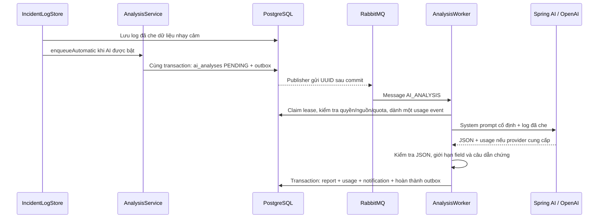

# Phase 05 — Phân tích nguyên nhân bằng LLM

Phase này triển khai backend/API: Spring AI 2.0.2 → OpenAI Chat Completions, worker RabbitMQ, lịch sử phân tích, token usage và notification/SSE. AI mặc định tắt; chưa có giao diện incident/AI hoặc kết quả chạy provider thật trong phần kiểm chứng local.

## 1. Luồng chạy và vai trò của từng class



- `AnalysisService`: kiểm tra quyền khi yêu cầu, tạo lịch sử và outbox. `AnalysisAccess` giữ các kiểm tra đọc/phân tích trong workspace.
- `AnalysisInput`: đọc snippets đã lưu, ghép lại, redaction thêm lần nữa với API key AI, rồi mới giới hạn đầu vào và tính SHA-256.
- `AnalysisStore`: transaction/lock, dành quota trước lời gọi mạng, ghi kết quả hoặc ý định retry sau lời gọi.
- `AnalysisClient`: dùng Spring AI `OpenAiChatModel`; không có advisor ghi prompt, chat memory hoặc tool callback.
- `AiHttpClient`: adapter HTTP cho SDK mà Spring AI sử dụng. Chỉ cho POST đúng endpoint cấu hình, không theo redirect, giới hạn body và deadline toàn response.
- `AnalysisOutput`: parse/validate JSON và dẫn chứng; không nhận báo cáo chỉ vì HTTP trả 200.
- `AnalysisRecovery`: đồng bộ lịch sử FAILED khi worker chết và outbox đã hết lượt retry.

Không gọi provider trong DB transaction. Khóa workspace phối hợp với thay đổi membership và giữ thứ tự commit notification như Phase 04.

Spring AI 2.0.x hỗ trợ Spring Boot 4.0/4.1; bản 2.0.2 của module OpenAI dùng SDK OpenAI phía dưới. Dự án cấu hình bean trực tiếp để không tự bật provider khi chưa có opt-in. [Spring AI getting started](https://docs.spring.io/spring-ai/reference/getting-started.html), [OpenAI Chat adapter](https://docs.spring.io/spring-ai/reference/api/chat/openai-chat.html)

## 2. Hai bảng mới và lịch sử không bị ghi đè

Migration `V6__ai_analysis_and_usage.sql`:

| Bảng | Vai trò |
|---|---|
| ai_analyses | Một lần yêu cầu phân tích, provider/model/prompt version, hash input, trạng thái, report và lỗi cố định |
| ai_usage_events | Một lần dành lượt gọi provider, attempt, token do provider báo, giá cấu hình, estimated cost và duration |

Mỗi lần phân tích lại dùng `requestId` UUID mới và tạo `ai_analyses` mới. Không ghi đè kết quả trước đó.

Gửi lại cùng requestId trong cùng workspace trả đúng bản ghi cũ; dùng cùng ID cho incident khác trả 409. Client nên tạo ID một lần cho một thao tác, giữ ID đó khi retry HTTP. Unique request key, một analysis đang chờ/chạy cho mỗi incident và claim outbox ngăn double-click/message trùng tạo lời gọi thừa.

Tự động chỉ tạo tối đa một analysis cho incident khi worker đã lưu log. Nếu AI đang tắt, quota đã hết hoặc log rỗng, capture vẫn hoàn tất; không bắt buộc phải có AI để giữ incident/log. Bật AI sau này không tự backfill các log đã có: dùng POST phân tích thủ công.

Trạng thái:

```text
PENDING → RUNNING → SUCCEEDED
             ├──→ PENDING + backoff khi lỗi có thể retry
             └──→ FAILED khi lỗi cố định hoặc hết lượt
```

AI thất bại không đổi lifecycle, phân công, severity hoặc xóa incident.

Composite FK bảo đảm analysis → incident và usage → analysis cùng workspace. Kết quả thành công giữ nguyên; endpoint không có thao tác sửa report.

## 3. Request và kiểm tra output

System prompt cố định yêu cầu báo cáo thận trọng bằng tiếng Việt. Log nằm trong user message riêng và được xem là dữ liệu không đáng tin. Model được yêu cầu bỏ qua chỉ dẫn, URL, role giả và yêu cầu chạy lệnh trong log.

Provider nhận JSON Schema với bốn field bắt buộc:

```json
{
  "summary": "Tóm tắt lỗi",
  "suspectedRootCause": "Nguyên nhân nghi ngờ và phần chưa chắc chắn",
  "suggestedFix": "Đề xuất cho con người kiểm tra",
  "evidence": ["Một câu xuất hiện nguyên văn trong log đã gửi"]
}
```

Ứng dụng kiểm tra lại độc lập:

- Chỉ một JSON object; không markdown fence, field lạ, key trùng hoặc JSON nối thêm.
- summary không rỗng, tối đa 2.000 ký tự; suspectedRootCause/suggestedFix tối đa 4.000 ký tự mỗi field.
- evidence có 1–5 câu khác nhau, mỗi câu 8–500 ký tự và phải xuất hiện trong input đã gửi.
- Output và evidence được redaction lại trước lưu. Response từ provider không hợp lệ không được lưu thành report thành công.
- Finish reason phải là stop; tool call, refusal hoặc output bị cắt không thành công.

JSON schema không chứng minh chẩn đoán đúng. Câu trích có thật chỉ chứng minh nguồn văn bản có trong input; nó không chứng minh lập luận AI đúng hoặc chỉ dẫn trong log đã được model bỏ qua. Fixture kiểm thử ranh giới chương trình, chưa đánh giá chất lượng model thật.

Dự án không đăng ký tools, không cấp GitHub credentials cho model, không chạy suggestedFix và không có nhánh tự push/execute/deploy. Mọi đề xuất cần con người xem xét. Phase 06 mới bổ sung knowledge/RAG và bảng liên kết evidence; Phase 05 giữ các câu trích và hash input.

[Spring AI structured output](https://docs.spring.io/spring-ai/reference/api/structured-output.html)

## 4. Giới hạn dữ liệu, timeout và retry

- Đầu vào chỉ đọc `incident_log_snippets`, không đọc raw GitHub logs. Ghép snippets trước redaction lại để phát hiện known secret nằm giữa hai đoạn.
- Mặc định giữ tối đa 16.000 ký tự cuối của log sau redaction; giới hạn cấu hình tối đa 32.768. Không cắt giữa surrogate pair.
- Provider nhận log đã giới hạn, không nhận email, token đăng nhập, installation token hoặc API key trong prompt.
- Hash input được lưu khi enqueue; worker kiểm tra lại hash, model và prompt version trước gọi. Thay đổi input/cấu hình không âm thầm dùng lại job cũ.
- Mặc định tối đa 2.048 output tokens; response HTTP tối đa 256 KiB.
- HTTP timeout mặc định 30 giây, cấu hình từ 1–60 giây; deadline bao gồm cả body sau headers. Redirect bị chặn; request URL không lấy từ log hoặc body API.
- SDK retries = 0. Retry nằm ở outbox, mặc định tối đa ba attempt, backoff theo cấu hình pipeline. Không bật vòng tự sửa JSON có thêm lời gọi AI ẩn.
- Provider 429/5xx, network/timeout và JSON sai được retry có giới hạn. HTTP lỗi cố định, redirect, nguồn/quyền bị thu hồi hoặc finish reason không hợp lệ kết thúc ngay.
- Queue `tracepilot.analysis`, routing key `incident.analysis`; DLQ chung `tracepilot.pipeline.sync.dead`. Message chỉ chứa UUID outbox.
- Một AI consumer, prefetch một message. AI có thể xử lý lịch sử khi pipeline worker tạm tắt; publisher chọn loại event theo cờ bật tương ứng.

Trước và sau lời gọi, worker kiểm tra repo/installation còn ACTIVE và người yêu cầu thủ công còn quyền. Thu hồi quyền trong lúc provider đang chạy ngăn lưu report; usage vẫn được ghi nếu đã có số liệu. Dữ liệu đã gửi đi trước lúc thu hồi không thể thu hồi ngược từ provider.

Redaction giữ giới hạn đã nêu ở Phase 04; không bảo đảm nhận ra mọi secret tùy ý hoặc cách mã hóa mới. `store=false` là tùy chọn của request; không phải cam kết zero data retention của provider. Cần chọn chính sách tài khoản/provider phù hợp trước khi bật với dữ liệu thật.

## 5. Token, chi phí và quota

Trước mỗi attempt có thể gọi mạng, transaction tạo một usage event UNKNOWN. Cách này giữ dấu vết cả khi worker chết hoặc không nhận được response.

- inputTokens/outputTokens lấy từ usage provider trả về. Thiếu usage hoặc không nhận được response: để null, không tự điền 0 hoặc đoán token từ số ký tự.
- Kết quả JSON bị từ chối nhưng provider có usage vẫn lưu số token và ước tính chi phí.
- Nếu đã có input/output tokens và cả hai đơn giá cấu hình, tính:
  `(inputTokens × inputPricePerMillion + outputTokens × outputPricePerMillion) / 1.000.000`.
- Thiếu giá hoặc usage: estimatedCostUsd = null. Giá dùng cho attempt được lưu cùng event; đơn vị USD/một triệu token.
- Đây là ước tính theo bảng giá cấu hình, chưa tính riêng cached token, service tier, discount hoặc hóa đơn thực tế.
- durationMs đo thời gian xử lý attempt bằng monotonic clock, không phải latency mạng thuần.

Mặc định tối đa **50 lượt đã dành trong 24 giờ gần nhất cho mỗi workspace**, tính cả retry, timeout và UNKNOWN. Kiểm tra dưới workspace lock trước lời gọi; quota không chỉ đếm analysis thành công. POST mới khi quota hết trả 429; job đã xếp hàng nhưng không còn quota kết thúc AI_DAILY_LIMIT trước gọi provider.

Không cam kết exactly-once billing: provider có thể đã xử lý request trước khi kết nối chết hoặc worker chết trước ghi kết quả. Retry có thể bị tính phí lại; event UNKNOWN được giữ và tiếp tục tính quota.

## 6. API và quyền

Prefix:

```text
/api/v1/workspaces/{workspaceId}/incidents/{incidentId}/analyses
```

| Method / suffix | Kết quả |
|---|---|
| GET ?page=0&size=20 | Lịch sử phân tích, mới trước |
| GET /{analysisId} | Một lần phân tích cùng report hoặc errorCode |
| GET /{analysisId}/usage | Các attempt, usage, cost và duration |
| POST | `{"requestId":"uuid-mới"}`, trả 202 cùng analysis PENDING |

OWNER/ADMIN hoặc MEMBER đang được phân công incident mới được POST. Thành viên ACTIVE đọc được lịch sử/usage trong workspace. Người ngoài nhận 404; chưa đăng nhập 401. Pagination giống Phase 04: page 0–10.000, size 1–100.

POST trả 409 khi chưa có log đủ điều kiện hoặc đã có analysis đang chờ/chạy; 503 khi AI tắt. Idempotent replay sau khi có kết quả vẫn trả 202 với cùng analysis ID.

SSE dùng endpoint notification của Phase 04. Type mới: `AI_ANALYSIS_SUCCEEDED` và `AI_ANALYSIS_FAILED`. Event chỉ có incident ID/metadata; client đọc history/report qua API sau khi nhận event. Notification lưu DB, có thể replay bằng Last-Event-ID. Report không được gửi qua SSE.

## 7. Cấu hình và chạy

Chạy kiểm thử fixture không cần API key thật:

```powershell
.\scripts\backend.ps1 -Task doctor
.\scripts\backend.ps1 -Task verify
```

Muốn thử provider thật, tự cấu hình trong `.env` không đưa vào Git:

```dotenv
AI_ENABLED=true
AI_API_KEY=<key-cua-ban>
AI_MODEL=<model-ho-tro-chat-completions-json-schema-va-max-completion-tokens>
AI_INPUT_PRICE_PER_MILLION=
AI_OUTPUT_PRICE_PER_MILLION=
```

Không có model hay đơn giá đoán sẵn. Chọn model còn hoạt động, quyền truy cập của tài khoản và giá hiện hành trước khi điền. Không dán key vào source, chat, command-line arguments hoặc screenshot.

```powershell
.\scripts\backend.ps1 -Task run
```

Backend áp dụng V6 khi khởi động. Nếu IntelliJ chưa nhận dependency mới trong pom.xml, dùng **Maven → Reload All Maven Projects**, JDK 21. Maven CLI và classpath IDE là hai trạng thái riêng.

Sau khi đăng nhập và có incident chứa log:

```powershell
$base = "http://127.0.0.1:8080/api/v1/workspaces/$workspaceId/incidents/$incidentId/analyses"
$headers = @{ Authorization = 'Bearer ' + $session.accessToken }
$requestId = [guid]::NewGuid().ToString()

$analysis = Invoke-RestMethod $base -Method Post -Headers $headers -ContentType 'application/json' -Body (@{
    requestId = $requestId
} | ConvertTo-Json)

Invoke-RestMethod "$base/$($analysis.id)" -Headers $headers
Invoke-RestMethod "$base/$($analysis.id)/usage" -Headers $headers
Invoke-RestMethod $base -Headers $headers
```

Giữ requestId khi thử lại cùng HTTP request. Tạo UUID mới khi chủ động yêu cầu một lần phân tích mới. Nếu FAILED, xem errorCode và usage; sửa nguyên nhân rồi yêu cầu lần mới. Không chuyển DLQ thành vòng requeue vô hạn.

## 8. Bằng chứng kiểm thử và phần còn lại

`AnalysisOutputTests`: schema field/type, key trùng, trailing JSON, field lạ, dẫn chứng bịa/trùng, độ dài và API key bị AI nhắc lại.

`Phase05IntegrationTests`: PostgreSQL/pgvector + RabbitMQ thật, GitHub HTTP fixture và AI HTTP fixture qua **Spring AI/SDK/transport thật của ứng dụng**. Bao phủ automatic pipeline, re-analysis/idempotency, request đang chờ, RBAC/tenant FK, retry/DLQ, timeout body, redirect/response quá lớn, output sai/finish reason, usage thiếu, ước tính với giá test, quota lúc enqueue và trước gọi provider, thu hồi membership khi đang chờ/nguồn khi đang chạy, phục hồi lịch sử, log rỗng và SSE AI event.

Giá 2/8 trong fixture chỉ là dữ liệu test để kiểm tra công thức, không phải bảng giá OpenAI.

Fixture không chứng minh model thật chẩn đoán đúng, kháng prompt injection về mặt ngôn ngữ, billing thực tế, retention provider, frontend AI hoặc triển khai production. Phase này chưa gọi provider thật, không thay đổi lifecycle incident, không thêm RAG/embedding và không tự thực thi đề xuất.
