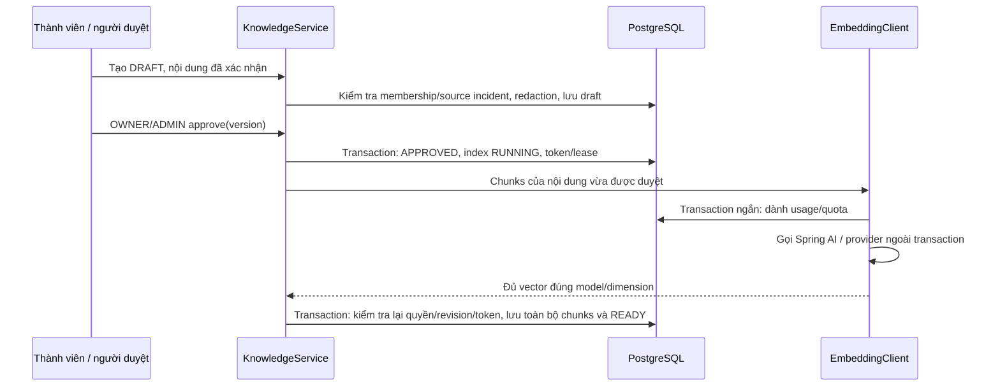
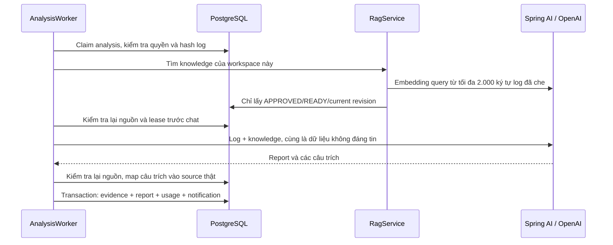

# Phase 06 — Knowledge, pgvector và RAG

Phase này thêm knowledge do con người xác nhận, embedding, tìm kiếm và nguồn dẫn chứng cho báo cáo AI. Tích hợp RAG mặc định tắt; kiểm thử backend dùng HTTP fixture, chưa gửi dữ liệu đến provider thật. Frontend đã bổ sung [kho kiến thức, quyền duyệt và dẫn nguồn](frontend-knowledge.md); bằng chứng UI/live được ghi riêng, không thay cho kiểm chứng provider thật.

## 1. Model và dimension được khóa

Model: **OpenAI text-embedding-3-small**, **1.536 chiều**, cosine distance.

Đây là hợp đồng của migration `V7__knowledge_vectors_and_evidence.sql`. DB dùng `VECTOR(1536)`, CHECK embedding_model và vector khác zero; Java kiểm tra model, đủ số vector, index không trùng, đủ chiều, phần tử hữu hạn và norm khác zero. Cấu hình đổi model/dimension sẽ bị từ chối, kể cả khi RAG tắt. Đổi hợp đồng này về sau cần migration và tạo lại embedding có kiểm soát.

OpenAI công bố model này có 1.536 chiều mặc định và tối đa 8.192 input tokens mỗi input. [Embedding guide](https://developers.openai.com/api/docs/guides/embeddings)

Không có thêm dependency Maven: dùng module Spring AI/OpenAI 2.0.2 đã có. SDK transport chỉ mở thêm POST `/embeddings` khi RAG bật; URL không lấy từ người dùng hoặc từ nội dung log.

## 2. Từ bản nháp đến knowledge tìm kiếm được



Ba bảng mới:

| Bảng | Vai trò |
|---|---|
| knowledge_articles | Nội dung, DRAFT/APPROVED/ARCHIVED, version, contentVersion, người duyệt và trạng thái indexing |
| knowledge_chunks | Nội dung đoạn đã che dữ liệu nhạy cảm, hash, vector, model và revision của article |
| analysis_evidence | Liên kết một câu trích đến đúng một log snippet hoặc knowledge chunk thật |

Composite FK bảo đảm article/chunk/analysis/evidence cùng workspace. Evidence log còn phải thuộc đúng incident của analysis.

Quyền và luồng:

- Thành viên ACTIVE xem article trong workspace, kể cả draft/history. Việc hiển thị draft trong API không khiến draft được dùng cho RAG.
- Thành viên tạo DRAFT và sửa draft của mình; OWNER/ADMIN sửa được article của workspace.
- Chỉ OWNER/ADMIN approve hoặc archive. MVP cho phép người quản lý duyệt bài của chính mình.
- Bài thủ công gắn sourceIncidentId yêu cầu incident cùng workspace và đang RESOLVED. Từ [Phase 10](phase-10.md), bản nháp có sourceAnalysisId SUCCEEDED cùng workspace/incident được tạo khi sự cố còn mở. Nội dung AI cần con người kiểm tra trước khi duyệt; lưu nháp chưa tạo chỉ mục.
- Bài không gắn incident có thể là tài liệu troubleshooting do con người viết.
- POST approve chỉ trả 200 khi vector đã READY. Nếu provider lỗi, article giữ APPROVED với indexStatus FAILED; chưa có chunks dở dang được công bố.
- Sửa article tăng contentVersion, đưa về DRAFT, hủy token indexing cũ và loại toàn bộ revision cũ khỏi truy xuất ngay trong transaction.
- Archive cũng loại bài khỏi truy xuất ngay.
- Chunks cũ không bị xóa hoặc sửa: báo cáo cũ vẫn giữ được nguồn lịch sử. Chỉ revision hiện tại của bài APPROVED/READY được tìm kiếm.
- version dùng cho optimistic concurrency; contentVersion chỉ tăng khi sửa nội dung. Request dùng version cũ nhận 409.

Approve chạy đồng bộ qua HTTP, deadline provider mặc định 30 giây. Không giữ DB transaction trong lúc chờ mạng. Client cần timeout phù hợp; nếu mất response, GET article trước khi thử lại. READY không được approve lại để tránh gọi provider thừa. RUNNING có lease 120 giây; nếu tiến trình chết, người quản lý có thể thử lại sau khi lease hết hạn, dùng version mới đọc.

## 3. Chia đoạn và bảo vệ dữ liệu

- Title tối đa 160 ký tự, rootCause 3.000, resolution 6.000.
- Service redaction và kiểm tra lại độ dài trước lưu.
- Ghép nội dung article rồi redaction thêm trước chia đoạn; chunk tối đa 1.200 đơn vị UTF-16, overlap 120, tối đa 12 chunks.
- Không cắt giữa surrogate pair. Mỗi chunk nằm dưới giới hạn input token của model ngay cả với UTF-8 nhiều byte.
- Tải embeddings theo batch, nhưng không tin thứ tự trả về: kiểm tra và ghép theo index. Thiếu/trùng vector hoặc sai model/dimension làm cả lần indexing thất bại.
- Một transaction cuối lưu toàn bộ chunks và READY. Sửa/archive/thu hồi quyền trong lúc gọi provider ngăn revision cũ được công bố.
- Hash được tính từ nội dung đã che. API không trả vector, API key, index token hoặc signed URL.
- Response embedding tối đa 1 MiB, timeout bao gồm cả body; không theo redirect và không có retry ẩn trong SDK.

Redaction vẫn có giới hạn đã nêu trong Phase 04. Không coi embedding hoặc log đã qua redaction là cam kết loại được mọi dữ liệu nhạy cảm.

## 4. Tìm kiếm exact, HNSW và hybrid

Mọi đường truy vấn đều ràng buộc **workspace của chunk và article**, `status=APPROVED`, `indexStatus=READY`, revision hiện tại và model đã khóa.

| Mode | Cách tìm |
|---|---|
| EXACT | Lọc tenant/trạng thái trong CTE MATERIALIZED, sau đó tính cosine và sort chính xác |
| APPROXIMATE | HNSW cosine, iterative_scan strict_order, ef_search 100; vẫn lọc tenant/trạng thái trong SQL |
| HYBRID | Hợp nhất top semantic và full-text bằng reciprocal rank fusion, hằng số 60 |

Worker RAG dùng HYBRID, mặc định topK=3. API tìm kiếm yêu cầu chọn mode rõ ràng, topK từ 1–5.

- Semantic channel dùng ngưỡng cosine tối thiểu mặc định 0,35.
- Full-text dùng PostgreSQL simple dictionary và websearch_to_tsquery, phù hợp bổ sung cho mã lỗi/identifier chính xác. Lexical hit có thể được chọn dù cosine dưới ngưỡng semantic.
- HYBRID lấy tối đa 20 ứng viên mỗi kênh rồi hợp nhất, không tự coi điểm cosine là độ chắc chắn của chẩn đoán.
- EXACT là mốc kiểm tra recall với tenant filter. HNSW có thể trả ít hơn topK hoặc mất recall khi lọc chọn lọc; chưa có benchmark chứng minh chế độ nào nhanh hơn với dữ liệu production.
- Index HNSW chỉ phục vụ mode APPROXIMATE. Không thêm cache hoặc GIN index khi chưa có workload/query plan làm căn cứ.

pgvector mặc định tìm exact; ANN đổi một phần recall để lấy tốc độ. Với HNSW, filter được áp dụng trong quá trình scan và cần đánh giá riêng trên phân bố tenant thực tế. [pgvector indexing/filtering](https://github.com/pgvector/pgvector#filtering)

## 5. RAG trong worker AI và bằng chứng



- Không có knowledge đủ điều kiện: bỏ qua query embedding, phân tích bằng log.
- Embedding lỗi khi cần retrieval: retry có giới hạn theo outbox; không âm thầm bỏ qua lỗi và tuyên bố đã dùng knowledge.
- Knowledge chiếm tối đa một nửa prompt budget sau khi trừ header. Giữ phần cuối log trong phần còn lại; tổng input nằm trong maxInputCharacters của Phase 05.
- Prompt xem cả log lẫn knowledge là dữ liệu không đáng tin, không thi hành chỉ dẫn trong đó. Model không có tools, quyền chạy lệnh hoặc push.
- Trước chat và trước commit, kiểm tra lại toàn bộ knowledge đã chọn bằng một truy vấn batch. Sửa/archive giữa chừng làm attempt bị từ chối, retry sẽ lấy context mới.
- Thu hồi dữ liệu sau khi đã gửi tới provider không thể thu hồi ngược request đã gửi.

Giữ contract `evidence: string[]` trong report. Server tự map từng câu trích tới một source đã cung cấp, ưu tiên log nếu cùng câu xuất hiện trong cả hai:

- Quote phải xuất hiện trong input thực sự gửi đi.
- Quote log phải nằm trong một snippet của đúng incident.
- Quote knowledge phải nằm trong một chunk đã chọn và còn hợp lệ lúc commit.
- Không chấp nhận quote chỉ nằm trong heading/identifier do server thêm vào.
- Quote vượt qua ranh giới hai source có thể bị từ chối; không gắn đại vào một source.
- Table CHECK yêu cầu đúng một trong logSnippetId/knowledgeChunkId; khóa ngoại chặn source khác workspace/incident.

Endpoint evidence trả sourceType, logSnippetId/logChunkIndex hoặc knowledgeChunkId/articleId/articleVersion, quote, source hash và cosine score nếu là knowledge. Điểm similarity không phải confidence của AI.

Prompt version mới là incident-rca-v2. Analysis cũ giữ nguyên lịch sử; không backfill nguồn giả cho report trước V7. Job pending có prompt version cũ sẽ kết thúc AI_SOURCE_CHANGED và cần một yêu cầu phân tích mới.

## 6. Usage, quota và giới hạn

V7 mở rộng ai_usage_events để ghi CHAT và EMBEDDING. Giữ nguyên dữ liệu CHAT đã có.

- Mỗi lời gọi embedding dành một event UNKNOWN trong transaction trước mạng.
- Publication/search độc lập có analysisId null; indexing có knowledgeArticleId.
- Query embedding của worker có analysisId và attempt để đối chiếu với CHAT cùng attempt.
- Unique key có thêm operation. Ghi usage CHAT chỉ cập nhật dòng CHAT, không ghi đè token/model/giá embedding.
- Toàn bộ lượt đã dành, kể cả UNKNOWN/retry, cùng tính vào quota 24 giờ của workspace từ Phase 05.
- Worker có thể đã dành một lượt CHAT trước khi query embedding thất bại; cách đếm này cố ý bảo thủ.
- Token embedding lấy từ provider. Không có usage/giá thì giữ null.
- EMBEDDING_PRICE_PER_MILLION là USD/một triệu input tokens; estimated cost = inputTokens × giá / 1.000.000.
- /analyses/{analysisId}/usage trả thêm operation, provider, model để phân biệt hai nhóm. Usage của publication/search độc lập hiện được giữ trong DB.

Không có exactly-once billing. Nếu provider đã xử lý trước khi kết nối/process chết, thử lại có thể bị tính phí thêm.

## 7. API

Prefix knowledge:

```text
/api/v1/workspaces/{workspaceId}/knowledge-articles
```

| Method / suffix | Body hoặc kết quả |
|---|---|
| GET ?page=0&size=20 | ArticlePage; page 0–10.000, size 1–100 |
| POST | sourceIncidentId tùy chọn, title, rootCause, resolution; trả 201 DRAFT |
| GET /{articleId} | Nội dung, status/indexStatus, version/contentVersion |
| PATCH /{articleId} | version, title, rootCause, resolution; đưa về DRAFT |
| POST /{articleId}/approve | `{"version":0}`; 200 khi READY, cùng route dùng retry FAILED/lease hết hạn |
| POST /{articleId}/archive | version hiện tại |
| POST /search | `{"query":"socket address occupied","topK":3,"mode":"EXACT"}` |

Dẫn chứng report:

```text
GET /api/v1/workspaces/{workspaceId}/incidents/{incidentId}/analyses/{analysisId}/evidence
```

Thành viên ACTIVE đọc evidence theo quyền analysis. Người ngoài workspace nhận 404, chưa đăng nhập 401. AI/RAG tắt vẫn tạo/sửa draft được; approve/search trả 503.

## 8. Chạy thử

Kiểm thử local không cần key thật:

```powershell
.\scripts\backend.ps1 -Task doctor
.\scripts\backend.ps1 -Task verify
```

Muốn dùng provider thật, chủ động cấu hình .env:

```dotenv
AI_ENABLED=true
AI_API_KEY=<key-cua-ban>
AI_MODEL=<chat-model-tuong-thich-Phase-05>
RAG_ENABLED=true
EMBEDDING_PRICE_PER_MILLION=
```

Không cần biến model/dimension embedding: chúng đã khóa trong cấu hình/migration. Giá để trống khi chưa kiểm tra bảng giá hiện hành. RAG dùng cùng API key/base URL đã cấu hình cho AI; không đưa key vào request body, source hoặc command line.

```powershell
.\scripts\backend.ps1 -Task run
```

Backend áp dụng V7 khi khởi động. IDE cần Reload All Maven Projects nếu chưa nhận Spring AI. Đặt timeout client đủ dài cho approve; không reset volume hoặc sửa V1–V6 để vượt lỗi migration.

Ví dụ sau khi đăng nhập như Phase 01:

```powershell
$base = "http://127.0.0.1:8080/api/v1/workspaces/$workspaceId"
$headers = @{ Authorization = 'Bearer ' + $session.accessToken }

$article = Invoke-RestMethod "$base/knowledge-articles" -Method Post -Headers $headers -ContentType 'application/json' -Body (@{
    title = 'EADDRINUSE khi khởi động dịch vụ'
    rootCause = 'Một tiến trình cũ vẫn giữ cổng của ứng dụng.'
    resolution = 'Xác định tiến trình giữ cổng, dừng tiến trình cũ rồi chạy lại dịch vụ.'
} | ConvertTo-Json)

$article = Invoke-RestMethod "$base/knowledge-articles/$($article.id)/approve" -Method Post -Headers $headers -ContentType 'application/json' -Body (@{
    version = $article.version
} | ConvertTo-Json)

Invoke-RestMethod "$base/knowledge-articles/search" -Method Post -Headers $headers -ContentType 'application/json' -Body (@{
    query = 'Không bind được socket vì địa chỉ đang được sử dụng'
    topK = 3
    mode = 'HYBRID'
} | ConvertTo-Json)
```

Sau đó yêu cầu analysis mới theo Phase 05, rồi đọc /evidence. Nếu approve lỗi, GET article để đọc indexStatus/errorCode/version mới trước khi retry. Nếu knowledge đã READY, không approve lại chỉ vì response trước bị mất.

## 9. Recall@K và mức bằng chứng

Dataset: backend/src/test/resources/evaluation/rag-retrieval.json, gồm sáu tài liệu troubleshooting và 12 truy vấn diễn đạt khác, có cả tiếng Việt. Mỗi truy vấn có một article liên quan.

`Recall@K = số article liên quan tìm được trong top K / tổng số article liên quan`. Test tính trung bình trên các truy vấn; với một source đúng mỗi query, Recall@1 cũng là tỷ lệ top-1 đúng.

Sau verify:

- backend/target/phase06-recall.json: kết quả EXACT/APPROXIMATE/HYBRID.
- backend/target/phase06-vector-plan.txt: EXPLAIN xác nhận HNSW cosine có thể được dùng khi ép planner trên fixture nhỏ. Đây không phải plan production hoặc benchmark tốc độ.
- backend/target/surefire-reports/: JUnit reports.

Phase06IntegrationTests dùng PostgreSQL/pgvector và RabbitMQ thật, HTTP GitHub/AI/embedding fixture đi qua Spring AI/SDK/transport thật của ứng dụng. Bao phủ quyền/workspace, các mode search, indexing atomic, reindex/archive/race, invalid vectors/model/batch, embedding failure, RAG evidence/usage, thay context trong khi chat và Recall@1. Unit tests thêm Unicode/redaction/chunk bounds/vector validation và prompt budget nhỏ.

Vector fixture được tạo có kiểm soát theo nhóm nghĩa của bộ test. Điểm Recall@1 = 1,0 trên fixture chỉ kiểm tra đường dữ liệu, SQL/filter/ranking và cách tính metric. Nó không chứng minh chất lượng embedding OpenAI trên repository thật.

Để đánh giá thực tế, chuẩn bị corpus đã được con người duyệt trong workspace kiểm thử, query/ground truth độc lập, bật provider có chủ đích và đo lại recall của exact/ANN/hybrid cùng latency/cost trên phân bố tenant thực tế. Chưa có lần đánh giá trả phí hoặc triển khai production nào trong phase này.
