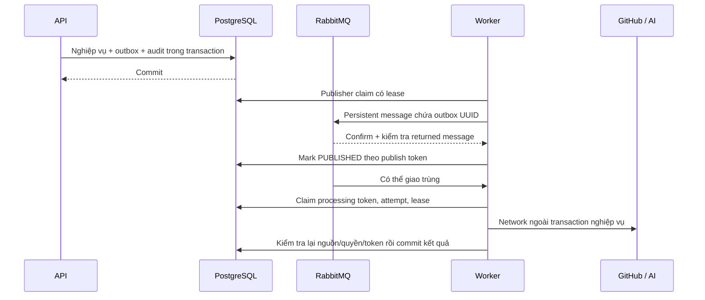

# Phase 08 — Hardening & reliability

Phase này bổ sung audit, giới hạn request, mã đối soát request/tác vụ, readiness và màn hình vận hành. Giữ outbox/inbox, claim token, lease, kiểm tra nguồn/quyền trước và sau network call của các phase trước.

## Chạy và thử

Tại root, bật Docker Desktop:

```powershell
.\scripts\backend.ps1 -Task doctor
.\scripts\backend.ps1 -Task verify
.\scripts\backend.ps1 -Task run
```

Trong `frontend/`, chạy `npm ci`, `npm run dev`, mở http://127.0.0.1:3000.

1. Đăng nhập OWNER/ADMIN, chọn workspace → **Vận hành & audit**.
2. Tab **Tác vụ** cho biết backlog từ DB và lịch sử workflow/log/AI. Xem mã lỗi, số attempt của đợt, tổng attempt và replay count.
3. Khi workflow/log FAILED và đã xác nhận gửi DLQ, người có quyền chọn **Thử lại tác vụ** → xem xác nhận → gửi. Kết quả 200 chỉ xác nhận đã lưu ý định xếp hàng.
4. OWNER mới được thử lại workflow sync. ADMIN có thể thử lại lấy log. MEMBER không đọc audit/operations và không có menu này.
5. Với AI FAILED, mở sự cố và yêu cầu phân tích mới theo Phase 05; không reset analysis/usage cũ.
6. Tab **Audit** xem ai đổi quyền, trạng thái, phân công, tri thức, feedback, yêu cầu phân tích/đồng bộ và thử lại tác vụ. Mã yêu cầu khớp `X-Request-ID` của backend.

Không có dữ liệu thì màn hình hiện trạng thái trống. Không bật AI/provider thật để kiểm thử mặc định.

### Preview bằng database test riêng

Khi cần kiểm chứng code hiện tại mà không dùng database Compose đang có, tại root chạy:

```powershell
.\scripts\backend.ps1 -Task preview
```

Backend ở `http://127.0.0.1:18080`, dùng PostgreSQL/pgvector và RabbitMQ tạm qua Testcontainers. Lệnh này ép tắt GitHub/pipeline/AI/RAG, bật rate limit, không gọi provider thật. Dữ liệu tài khoản/workspace thử nằm trong database tạm; không ghi vào volume Compose local. Dùng `Ctrl+C` để dừng preview và chờ container được thu hồi.

Terminal thứ hai tại `frontend/`:

```powershell
$env:BACKEND_URL = 'http://127.0.0.1:18080'
$env:APP_ORIGIN = 'http://127.0.0.1:3001'
npm run dev -- --port 3001
```

Terminal thứ ba tại `frontend/`, giữ server đang chạy:

```powershell
$env:FRONTEND_URL = 'http://127.0.0.1:3001'
$env:TRACEPILOT_LIVE = '1'
npm run test:live
Remove-Item Env:TRACEPILOT_LIVE
Remove-Item Env:FRONTEND_URL
```

Preview tắt pipeline nên màn hình tác vụ trống là đúng. Ca phục hồi GitHub/AI, broker outage, replay và DLQ được kiểm tra trong integration tests với HTTP fixture và broker thật.

### Nhận diện và dọn container test

DB/broker test mới có label `com.tracepilot.test=true`, kèm `org.testcontainers.sessionId` để phân biệt các phiên. Xem danh sách:

```powershell
docker ps -a --filter label=com.tracepilot.test=true --format '{{.ID}} {{.Names}} {{.Status}}'
```

Chỉ dọn container sau khi JVM test/preview tương ứng đã dừng. Nếu terminal/Docker bị đóng đột ngột làm container sót lại, đối chiếu ID trong log và session label, rồi dùng `docker rm -v <id-db-test> <id-broker-test>` cho đúng phiên. `-v` ở đây xóa anonymous volume của container test. Không dùng prune toàn Docker hoặc xóa các volume `tracepilot_postgres_data`/`tracepilot_rabbitmq_data`. Container test cũ chưa có label TracePilot cần đối chiếu bằng ID và log.

## Audit cùng transaction

Migration mới **V9__audit_and_reliability.sql** tạo `audit_logs`, `rate_limit_buckets` và thêm `replay_count`/`total_processing_attempts` cho outbox. V1–V8 giữ nguyên.

`AuditLog.record` dùng transaction MANDATORY: thay đổi nghiệp vụ và audit cùng commit/rollback. Audit không ghi được thì nghiệp vụ không được commit. Kiểm thử mô phỏng DB từ chối INSERT audit để xác nhận không còn workspace tạo dở.

| Action | Đối tượng và dữ kiện lưu |
|---|---|
| WORKSPACE_CREATED | Workspace ID; không chép tên/slug |
| MEMBER_ADDED / MEMBER_ROLE_CHANGED / MEMBER_REMOVED | User ID, role và trạng thái kích hoạt lại |
| INCIDENT_STATUS_CHANGED / INCIDENT_ASSIGNED | Incident ID, trạng thái hoặc assignee ID |
| KNOWLEDGE_CREATED / EDITED / APPROVED / ARCHIVED | Article ID và revision liên quan; không chép title/root cause/resolution |
| ANALYSIS_REQUESTED | Analysis ID, incident ID |
| WORKFLOW_SYNC_REQUESTED | Outbox ID, repo/run/attempt |
| FEEDBACK_SAVED | Feedback/analysis ID, helpful, reason, version; không chép comment |
| OUTBOX_REPLAYED | Outbox ID, replay count mới, số attempt trước |

Metadata chỉ nhận UUID, enum, boolean, Integer/Long từ các call site có key cố định; từ chối chuỗi tự do hoặc object/payload. Actor lấy từ JWT/service, không nhận từ JSON người dùng. Request ID do server tạo. Các thao tác giữ nguyên trạng thái hoặc PUT feedback cùng nội dung không phát sinh audit lặp. Approve knowledge ghi nhận việc duyệt vào APPROVED/indexing; không có nghĩa provider đã tạo embedding thành công.

Audit bắt đầu từ khi V9/code mới hoạt động; không dựng lại lịch sử cũ. API chỉ cho đọc, không có sửa/xóa audit. Đây là lịch sử ở tầng ứng dụng, **chưa phải kho chống can thiệp bởi DBA**. Không thêm trigger cấm xóa, cơ chế chữ ký hoặc retention tự động chưa có yêu cầu.

## API

Base: `/api/v1/workspaces/{workspaceId}`. Cần Bearer JWT và membership ACTIVE.

| Method | Path sau base | Quyền / kết quả |
|---|---|---|
| GET | `/audit-logs?page=0&size=20` | OWNER/ADMIN; DTO items/page/size/total |
| GET | `/operations` | OWNER/ADMIN; backlog theo event type + processing status |
| GET | `/operations/outbox?page=0&size=20` | OWNER/ADMIN; metadata tác vụ |
| POST | `/operations/outbox/{eventId}/retry` | OWNER với workflow; OWNER/ADMIN với log |

Page 0–10.000, size 1–100. Outsider/REMOVED hoặc event sai workspace trả 404; MEMBER trong workspace trả 403. API và UI không trả payload outbox, log, prompt, token hoặc vector trong màn hình vận hành.

Body thử lại:

```json
{ "replayCount": 0 }
```

Server kiểm tra quyền dưới workspace lock, nguồn repo/installation hiện tại, event type, FAILED + publication PUBLISHED và replayCount đã đọc. Sai trạng thái/count trả 409. AI luôn từ chối replay cùng bản ghi bằng 409. Chưa bật pipeline trả 503.

Replay tăng count, reset số attempt của **đợt** về 0 và xếp lại cùng outbox ID, giữ tổng attempt. Mỗi lần claim tăng cả attempt đợt và tổng. Token claim của đợt trước bị vô hiệu; worker cũ không thể ghi đè kết quả đợt mới. Không tự đọc/rút message cũ khỏi DLQ toàn cục: DLQ vẫn là bằng chứng vận hành cho operator.

## Retry, broker và transaction boundaries



- Inbox webhook dùng delivery ID/digest và HMAC raw body. Rabbit có thể giao trùng; DB claim và unique business keys chặn ghi trùng, không tuyên bố exactly-once delivery.
- Processing tối đa 3 attempt/đợt, retry/backoff giới hạn; hết attempt chuyển FAILED và publisher gửi DLQ.
- Broker unavailable hoặc mất binding: giữ outbox, publication backoff 2–30 giây rồi tiếp tục đến khi broker phục hồi. Không bỏ tác vụ chỉ vì chưa gửi được sang broker; số vòng publish không giới hạn như số attempt xử lý.
- Publisher confirm mất/timeout có thể dẫn tới publish lại; consumer vẫn phải idempotent. Acknowledge chỉ sau khi lưu kết quả hoặc retry intent.
- Lease hết hạn được recovery đưa về RETRY/FAILED; token cũ không còn hiệu lực.
- Provider có thể đã xử lý hoặc tính phí dù client mất response. AI giữ usage UNKNOWN khi không biết; retry không có nghĩa một provider call exactly-once.
- Manual retry cũng ghi audit trong transaction. Không dùng SQL sửa trạng thái tùy tiện hoặc reset dữ liệu để thử lại.

Các test Phase 03–06 vẫn xác minh webhook/message trùng, partial snapshot, lease/revocation, broker/binding outage, GitHub/AI error/timeout, retry bounded và DLQ với broker thật + provider HTTP fixture.

## Rate limiting dùng PostgreSQL

Mặc định bật, không thêm Redis. Một UPSERT có điều kiện trên khóa `(scope, HMAC(identity), bucket_start)` cấp lượt nguyên tử dùng chung giữa các instance. Bộ đếm nằm trong transaction riêng trước nghiệp vụ; đăng nhập sai hoặc nghiệp vụ rollback không hoàn lại lượt.

| Nhóm | Identity | Giới hạn mặc định |
|---|---|---|
| Register/login và POST auth khác | Peer IP của kết nối | 60/phút |
| Refresh/logout | Peer IP, bucket session riêng | 120/phút |
| Login account | Email trim + lowercase | 10/5 phút, áp dụng cả email không tồn tại |
| API GET đã xác thực | User ID | 600/phút |
| API write đã xác thực | User ID | 120/phút |
| POST sync/analyses/search/approve/retry | User ID, thêm bucket expensive | 10/phút |

Đây là **fixed window**, không phải sliding window: gần ranh giới có thể dùng hai window liên tiếp. Đếm cả request bị nghiệp vụ từ chối. JWT/quyền workspace/quota AI vẫn kiểm tra độc lập; throttle không cấp thêm quyền.

Rate key HMAC-SHA256 dùng signing secret cùng domain prefix; DB không lưu IP/email/token dạng rõ. Đây là pseudonymous identifier, không phải đảm bảo ẩn danh. Các instance cần cùng secret và đồng hồ đồng bộ. Đổi signing secret cũng đổi rate key.

429 có `Retry-After` là số giây đến cuối window; Next chỉ chuyển tiếp giá trị hợp lệ, client hiển thị thời gian chờ và không tự retry 429. Store/transaction rate limit lỗi thì trả 503 và không chạy nghiệp vụ. Job cleanup xóa tối đa 1.000 bucket hết hạn/lần mỗi 60 giây; không xóa dữ liệu nghiệp vụ.

Frontend phân biệt 503 do rate limit/DB tạm ngừng với lỗi tích hợp GitHub chưa cấu hình. Không hướng người dùng sửa GitHub khi backend đang mất khả năng lưu dữ liệu hoặc cấp lượt request.

**Ranh giới proxy:** backend dùng remote peer IP, bỏ qua X-Forwarded-For do client cung cấp. Với Next BFF, nhiều người dùng có thể chung bucket IP của Next; account/user bucket vẫn riêng. Không tin một forwarded header để né giới hạn. Trước khi tăng tải qua proxy cần cấu hình rate policy ở trusted edge và điều chỉnh hạn mức theo topology; chưa có cơ chế IP forwarding có chữ ký hoặc distributed BFF session store.

Health probes và webhook không dùng các bucket API trên. Webhook vẫn bị giới hạn raw body, kiểm HMAC/dedup; edge protection/DDoS là công việc triển khai. API JWT sai bị Spring Security từ chối trước filter; rate limiting ứng dụng không thay bảo vệ biên mạng.

Cấu hình trong `.env` (không bắt buộc khai báo vì đã có mặc định):

```dotenv
RATE_LIMIT_ENABLED=true
RATE_AUTH_PER_MINUTE=60
RATE_SESSION_PER_MINUTE=120
RATE_READS_PER_MINUTE=600
RATE_WRITES_PER_MINUTE=120
RATE_EXPENSIVE_PER_MINUTE=10
RATE_LOGIN_PER_ACCOUNT=10
```

Giới hạn hợp lệ 1–100.000. Các integration test phase cũ tắt limiter để độc lập thứ tự test; Phase 08 bật thật và test request đồng thời, account normalization, peer-IP spoof, read/expensive budgets và cleanup.

## Truy vết, health và metrics

- Backend tạo UUID `X-Request-ID` cho request, không dùng giá trị client gửi. MDC đưa ID vào log và audit; Next giữ header UUID hợp lệ khi chuyển tiếp response.
- Worker đặt `outboxId` trong MDC, log event type/attempt cố định, dọn MDC khi kết thúc. Từ audit WORKFLOW_SYNC_REQUESTED/OUTBOX_REPLAYED có thể tra request → outbox → worker log. Đây là correlation ID, **chưa phải distributed tracing/OpenTelemetry spans**.
- `/actuator/health/liveness` phản ánh process state. `/actuator/health/readiness` gồm readinessState + PostgreSQL + RabbitMQ. Broker ngừng thì readiness 503, liveness vẫn 200; provider GitHub/AI không nằm trong liveness để tránh restart loop do lỗi bên ngoài.
- `BacklogMetrics` cập nhật Micrometer gauge `tracepilot.outbox.backlog` mỗi 10 giây. Chỉ có tag event type và processing state cố định; không có workspace/user/URL/request ID làm metric label.
- Dashboard API lấy backlog từ DB theo workspace; không coi đó là số message tức thời trong Rabbit queue. Tuổi là thời gian từ createdAt của công việc cũ nhất trong nhóm, gồm thời gian retry.
- Actuator HTTP chỉ mở health. Metrics JVM/HTTP và gauge nằm trong registry; `/actuator/metrics`/`prometheus` không public và JWT thành viên cũng không được đọc metrics toàn hệ thống. Exporter/collector cần bảo vệ riêng khi triển khai Phase 09.
- Index audit theo workspace/ngày và index partial outbox cho backlog là để phục vụ các truy vấn mới; chưa có benchmark tải thật hoặc kết luận nhanh hơn production.

## Đọc code và kiểm chứng

Đọc theo thứ tự:

1. `audit/AuditLog` và các call site trong workspace/incident/knowledge/analysis/quality/pipeline service.
2. `RateLimitFilter` → `RateLimiter`, và account limit trong AuthController trước AuthService transaction.
3. `OperationsService` → `OperationsRepository.retry` → OutboxRepository claim/token.
4. `RequestTraceFilter`, worker MDC, `BacklogMetrics` và cấu hình health.
5. `frontend/components/operations.tsx`, BFF allowlist và header forwarding.

```powershell
# Root
.\scripts\backend.ps1 -Task verify

# frontend/
npm run typecheck
npm run format:check
npm run build
npm run test:ui
# Cần backend mới; kiểm chứng cookie/audit/headers qua Next thật
$env:TRACEPILOT_LIVE = '1'
npm run test:live
Remove-Item Env:TRACEPILOT_LIVE
```

Maven/Testcontainers, browser fixture, tích hợp Next → Spring, IDE và triển khai là các mức bằng chứng riêng. Test mặc định không gửi dữ liệu hoặc trả tiền cho GitHub/AI provider thật.

DB Compose local đã có xung đột V4 từ trước (applied `-702013013`, source/fresh schema `6650674`); không repair/reset hoặc sửa V4. Code/migration mới được kiểm tra trên DB thử riêng. Muốn nâng DB hiện có cần đối soát schema và lịch sử V4 trước, không coi test V9 thành công trên DB riêng là đã migrate DB đó. IntelliJ cần Reload All Maven Projects nếu vẫn chưa nhận Spring AI.

## Kết quả chốt local — 09/11/2026

| Phạm vi | Kết quả và bằng chứng |
|---|---|
| Toàn bộ backend | `.\scripts\backend.ps1 -Task verify`: **133 test**, 0 failure/error/skipped, BUILD SUCCESS; báo cáo `backend/target/surefire-reports/`, log local `.verification/phase08-completion-backend.log` |
| Riêng Phase 08 | **19 integration test**: audit cùng rollback, quyền/cách ly tenant, rate limit nguyên tử, correlation, readiness và backlog; thêm replay đồng thời chỉ nhận một generation/audit, ADMIN phục hồi log vẫn redacted, từ chối repo/installation bị thu hồi |
| Frontend build | `typecheck`, `format:check`, production `build` đạt; 503 rate limit/DB không còn bị báo nhầm thành lỗi GitHub |
| Browser fixture | **43 test đạt**, gồm 11 test reliability; axe và không tràn ngang ở 1440/320px; ảnh tại `.verification/phase08/operations-*.png` |
| Next → Spring | **9 live test đạt** qua production Next port 3001 → Spring preview port 18080; cookie/refresh/logout, audit/request ID, Retry-After, RBAC và tenant isolation |
| Container | Đã dọn 4 container preview cũ đối chiếu bằng ID trong log (2 Phase 08, 2 preview giao diện trước đó), cùng anonymous volume của chúng. Preview mới dừng graceful, test tự thu hồi; cuối lượt không còn Testcontainers. Hai container/volume Compose local được giữ nguyên |

Phục hồi lỗi GitHub/AI dùng HTTP fixture trong các integration test Phase 03–06; không gọi provider thật hoặc phát sinh phí. Tài khoản/workspace live được tạo trong DB preview tạm và đã được thu hồi cùng container. Chưa xác nhận IntelliJ, remote CI, provider thật, triển khai hoặc nâng cấp DB Compose cũ. Phase 09 chưa được triển khai trong lượt chốt này.
